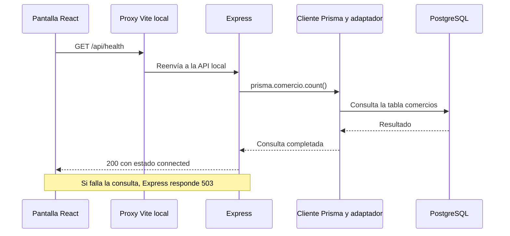
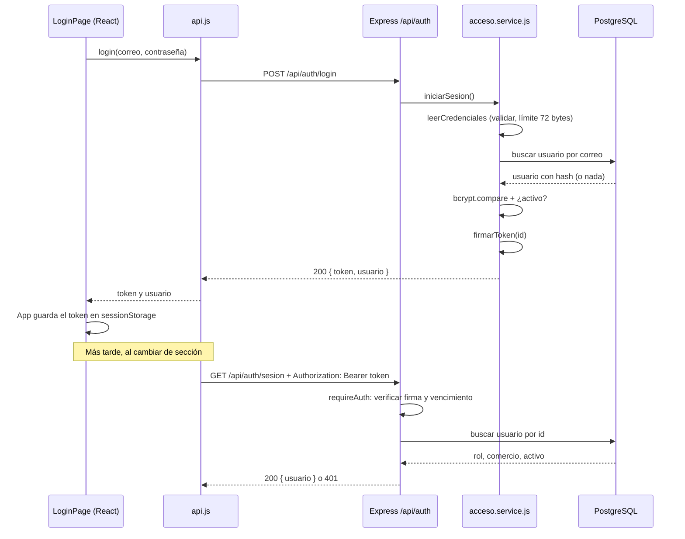
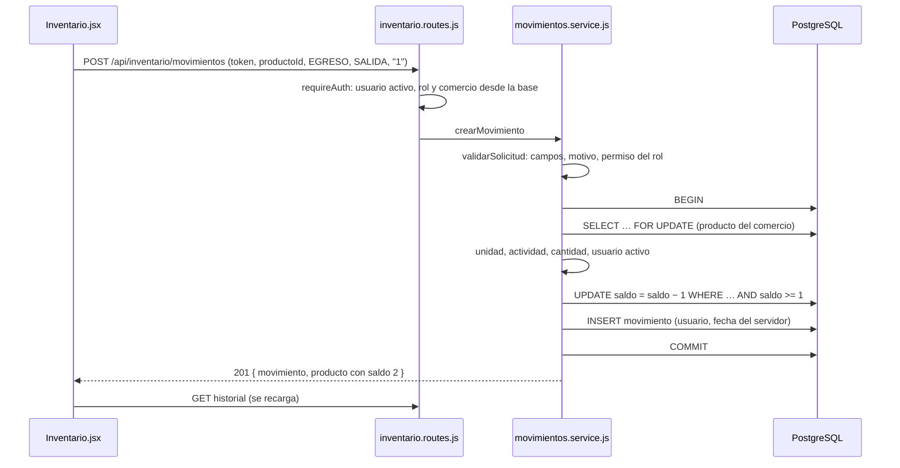

# Preparación de la defensa oral

Tomás Anchorena y Nazareno Romero · TFI de la Tecnicatura Universitaria en Programación, UTN.

Documento de estudio compartido. Creado el 06/11/2026. La defensa será individual y cada integrante deberá explicar tanto su participación como el trabajo del compañero y el funcionamiento general del proyecto.

## Cómo estudiar y mantener esta guía

Primero leer el problema y el recorrido general. Después estudiar una etapa junto con sus archivos. Al terminar, intentar responder las preguntas sin mirar y mostrar en el código dónde ocurre lo explicado. Si una respuesta todavía cuesta, anotarla como pendiente de practicar.

Las etapas 0 y 1 se explican a partir del código local y los registros de ejecución de octubre. La etapa 1 está cerrada por el equipo. La etapa 2 se explica a partir de la versión con las correcciones de la revisión (`5ce7c91`), aprobada por Codex e integrada a `main` el 09/11 (`51e1853`). La etapa 3 está cerrada e integrada. La etapa 4 se explica a partir de la rama `etapa-4-inventario` (`bc7465d`), con la implementación y la revisión cruzada aprobadas; está integrada a `main` (`3b939c0`). Las explicaciones sobre futuras funciones se identifican como diseño previsto.

Los ejemplos orales son una guía para practicar. Cada integrante debe ajustarlos a las tareas que realmente realizó. El registro de participación permite identificar responsables y evidencias. [Registro de participación](docs/participacion-y-defensa.md).

### Índice de estudio

- [El proyecto y las palabras básicas](#el-proyecto-y-las-palabras-básicas)
- [Etapa 0 — Organización y alcance](#etapa-0--organización-y-alcance)
- [Etapa 1 — Entorno y recorrido completo de conexión](#etapa-1--entorno-y-recorrido-completo-de-conexión)
- [Etapa 1 — Base de datos y reglas](#etapa-1--base-de-datos-y-reglas)
- [Etapa 1 — Seed y contraseñas](#etapa-1--seed-y-contraseñas)
- [Etapa 1 — Configuración, errores y pruebas](#etapa-1--configuración-errores-y-pruebas)
- [Etapa 1 — Aportes y práctica oral](#etapa-1--aportes-y-práctica-oral)
- [Etapa 2 — Problema, estado y alcance](#etapa-2--problema-estado-y-alcance)
- [Etapa 2 — Conceptos desde cero](#etapa-2--conceptos-desde-cero)
- [Etapa 2 — Recorrido completo del login](#etapa-2--recorrido-completo-del-login)
- [Etapa 2 — Archivos y responsabilidades](#etapa-2--archivos-y-responsabilidades)
- [Etapa 2 — Decisiones y motivos](#etapa-2--decisiones-y-motivos)
- [Etapa 2 — Ejemplos concretos](#etapa-2--ejemplos-concretos)
- [Etapa 2 — Pruebas](#etapa-2--pruebas)
- [Etapa 2 — Aportes y práctica oral](#etapa-2--aportes-y-práctica-oral)
- [Etapa 2 — Resumen de repaso](#etapa-2--resumen-de-repaso)
- [Etapa 3 — Catálogo](#etapa-3--catálogo)
- [Etapa 4 — Movimientos e historial](#etapa-4--movimientos-e-historial)
- [Etapas siguientes](#etapas-siguientes)
- [Acuerdo para ampliar esta guía](#acuerdo-para-ampliar-esta-guía)

## El proyecto y las palabras básicas

### Qué problema queremos resolver

Un comercio chico necesita saber qué tiene, qué entró, qué salió y qué debería reponer. Llevarlo en una libreta o en mensajes separados dificulta consultar el saldo y reconstruir un error. Stock Manager reúne productos, movimientos y faltantes en una aplicación web.

El MVP, o primera versión con el alcance comprometido, contempla catálogo, ingresos y egresos, alertas y listas de reposición por proveedor. El dueño administra el catálogo, realiza ajustes y prepara reposición. El empleado consulta y registra operaciones habituales. Facturación fiscal, pagos, registro público de comercios y seguimiento de órdenes quedan fuera del alcance aprobado. Así concentramos el desarrollo en inventario y reposición.

Un ejemplo del funcionamiento previsto es cargar harina, registrar su salida, detectar que quedó por debajo del mínimo y preparar una lista para el proveedor. La recepción de esa mercadería se registra luego como un ingreso. Las reglas completas están documentadas por separado. [Requerimientos](docs/segunda_entrega/01-requerimientos.md), [reglas de negocio](docs/segunda_entrega/02-reglas-de-negocio.md).

### Qué hace cada parte

| Concepto | Explicación aplicada al proyecto |
|---|---|
| Frontend | La parte que se ve y utiliza en el navegador. Muestra pantallas, recibe datos y comunica resultados. Usamos React. |
| Backend | El programa que recibe solicitudes, controla reglas y consulta o modifica la base. Usamos Node.js y Express. |
| Base de datos | Guarda información de manera persistente y aplica restricciones. Usamos PostgreSQL. |
| API | El conjunto de operaciones que el backend ofrece para que la interfaz se comunique con él. |
| HTTP | El protocolo de solicitudes y respuestas entre navegador y servidor. |
| Endpoint | Una operación de la API identificada por método y ruta, como `GET /api/health`. |
| GET | Método HTTP que usamos para consultar. En la etapa 1 consulta disponibilidad. |
| JSON | Formato de texto para intercambiar datos estructurados, por ejemplo `{ "status": "ok" }`. |
| ORM | Herramienta para trabajar con tablas mediante objetos y métodos del lenguaje. Prisma es el ORM elegido. |
| SQL | Lenguaje de PostgreSQL para definir estructuras, consultar y modificar datos. Aparece directamente en migraciones y algunas pruebas. |
| Módulo | Parte del código con una responsabilidad, como acceso, catálogo o inventario. |
| Dependencia | Paquete de código externo que usamos, como Express o React. npm los instala. |
| Entorno | Configuración y servicios donde corre la app. Distinguimos desarrollo, pruebas y producción. |

El frontend necesita al backend para aplicar reglas sobre datos compartidos. El backend accede a PostgreSQL mediante Prisma. Las credenciales de PostgreSQL se configuran en el servidor. Un navegador siempre puede enviar solicitudes modificadas, por lo que los controles decisivos de permisos y negocio deben estar también en el backend.

## Etapa 0 — Organización y alcance

### Qué hicimos y por qué

Partimos de la propuesta y el diseño aprobados. Antes de implementar, ordenamos el trabajo en etapas con un resultado observable y pruebas asociadas. Cada función se desarrollará con su pantalla, validación y persistencia para poder probar un recorrido concreto. Esta organización ayuda a detectar errores antes de construir módulos que dependan de ellos.

El orden responde a dependencias. Acceso identifica quién opera; catálogo define sobre qué productos se opera; inventario registra movimientos; alertas y reposición usan los saldos. Después verificamos el conjunto, completamos el despliegue y realizamos el piloto y la entrega. La hoja de ruta detalla las tareas y los criterios de cierre. [Plan de desarrollo](docs/plan-desarrollo.md).

### Cómo nos repartimos

| Etapa | Coordinación e implementación asistida | Revisión |
|---|---|---|
| 1. Entorno y base | Tomás con Codex | Nazareno con Claude |
| 2. Acceso y permisos | Nazareno con Claude | Tomás con Codex |
| 3. Catálogo | Tomás con Codex | Nazareno con Claude |
| 4. Movimientos e historial | Nazareno con Claude | Tomás con Codex |
| 5. Alertas y reposición | Tomás con Codex | Nazareno con Claude |
| 6. Verificación y despliegue | Ambos, tareas por concretar | Cruzada |
| 7. Piloto, documentación y entrega | Ambos, tareas por concretar | Cruzada |

Este reparto se acordó el 04/11. La etapa 0 corresponde a la organización compartida. El código se produce con asistencia de IA. El aporte de cada estudiante se registra mediante las decisiones, coordinación, verificaciones y revisiones que efectivamente realice. Ambos tienen que aprender a explicar el resultado y sus límites.

La revisión se hace sobre una versión identificable. El responsable comparte el trabajo, el compañero revisa con su asistente y las observaciones se resuelven antes de continuar con una etapa dependiente. La revisión puede detectar un error, proponer una mejora o confirmar que una decisión está justificada. Se conserva el motivo de la resolución.

### Qué significa compartir una versión

Git registra cambios del proyecto. Un **commit** guarda una versión local con un identificador. **Push** la envía al repositorio remoto. **Fetch** actualiza la información que tenemos de ese remoto. **Pull** trae e integra sus cambios en la rama local. Una **rama** permite desarrollar una línea de trabajo, como `etapa-2-acceso`, para revisarla antes de unirla con `main` mediante una integración o merge.

Los archivos sin commit en la computadora de un integrante todavía no se obtienen desde el remoto. Por eso para revisar una etapa necesitamos que esté compartida y saber la rama y el commit. Los comandos de Git quedan a cargo de los integrantes por el acuerdo de trabajo.

### Qué quedó pendiente al preparar el proyecto

Se dejaron identificadas la coordinación del comercio piloto y la elección de cuentas y servicios para publicar. Son decisiones externas al código. Se pueden desarrollar y probar funciones locales mientras se resuelven, pero la prueba online y el piloto deben verificarse en sus entornos reales.

**Pregunta para practicar:** ¿por qué dividieron el trabajo por etapas?

**Respuesta orientativa:** «Porque los módulos dependen entre sí. Primero verificamos la conexión y la estructura de datos, luego quién puede operar, después productos y movimientos, y finalmente los faltantes. En cada paso dejamos pruebas y una revisión del compañero para detectar problemas antes de seguir».

## Etapa 1 — Entorno y recorrido completo de conexión

### Qué quedó funcionando

La etapa 1 construyó una aplicación mínima ejecutable. Al abrir la pantalla, React consulta el backend. Express realiza una consulta real a PostgreSQL usando Prisma y devuelve un estado. React muestra conexión correcta o un error con posibilidad de reintentar.

Además quedaron el esquema operativo, la migración inicial, los datos ficticios repetibles, validaciones compartidas y pruebas. El login y las operaciones de catálogo e inventario corresponden a las etapas siguientes. Los nombres de esos módulos en la pantalla inicial anuncian el trabajo previsto. [Informe de etapa 1](docs/implementacion/etapa-1.md).

### Por qué usamos este stack

Estas tecnologías ya formaban parte de la propuesta. La etapa 1 concretó su configuración y comprobó que trabajan juntas.

| Elección | Motivo aplicado al proyecto y costo que asumimos |
|---|---|
| React | Permite organizar pantallas en componentes y actualizarlas cuando cambia su estado. Hay que aprender cómo se manejan estado y efectos. |
| Node.js + Express | Permite escribir el servidor en JavaScript y definir rutas y controles comunes. Las reglas del negocio y los permisos deben implementarse explícitamente. |
| PostgreSQL | El proyecto tiene entidades relacionadas y necesita restricciones y transacciones para conservar saldos e historial coherentes. Requiere diseñar y mantener el esquema. |
| Prisma | Ofrece un cliente generado desde el modelo y herramientas de migración. Algunas restricciones se agregan mediante SQL, y las reglas de negocio siguen requiriendo código. |
| JavaScript con módulos ES | Mantiene el lenguaje previsto del backend. `import` y `export` permiten repartir responsabilidades entre archivos. |
| tsx | Ejecuta nuestro JavaScript y el TypeScript del cliente generado de Prisma elegido. Evita un paso separado de compilación del servidor en este montaje y agrega una dependencia de ejecución. |
| Vite | Da un servidor de desarrollo para React y genera los archivos del frontend para publicar. La compilación de frontend sigue siendo necesaria. |
| npm workspaces | Organiza frontend y backend dentro del mismo repositorio con una instalación y un lockfile compartidos. |

Las versiones que se instalaron y probaron en esta etapa fueron Node 24.22.1, Prisma/cliente/adaptador 7.10.1, Express 5.3.0, React 19.3.1, Vite 8.3.5 y tsx 4.23.15. La decisión busca repetir el entorno comprobado. `package-lock.json` registra también las dependencias indirectas. `npm ci` instala según ese archivo.

`.nvmrc` y `.node-version` indican Node 24.22.1 como versión recomendada. El rango de `engines` es `>=24.22.1 <25`, y `.npmrc` activa su control estricto. Las versiones 24.x posteriores al mínimo entran en ese rango. tsx también tiene requisitos de compatibilidad, de modo que el equipo usa el entorno probado. [Comandos y workspaces](package.json), [dependencias del backend](backend/package.json), [dependencias del frontend](frontend/package.json).

### Cómo se organiza el código

| Archivo o carpeta | Qué buscar al estudiar |
|---|---|
| `frontend/src/main.jsx` | Monta el componente principal dentro del HTML y carga estilos. |
| `frontend/src/app/App.jsx` | Describe la pantalla y cambia entre comprobando, conectado y error. |
| `frontend/src/services/api.js` | Envía la solicitud de disponibilidad y verifica la respuesta. |
| `backend/src/app.js` | Define la aplicación Express, sus controles comunes y sus rutas. |
| `backend/src/server.js` | Lee configuración, crea Prisma, abre el puerto y gestiona el cierre. |
| `backend/src/lib/` | Funciones compartidas de configuración, Prisma, validación y diagnóstico. |
| `backend/prisma/` | Modelo, migraciones y seed. |
| `backend/tests/` | Pruebas de lógica, HTTP e integración con base real. |
| `docs/` | Diseño, plan, evidencias y registro de participación. |

Separar `app.js` de `server.js` permite probar la aplicación con una dependencia controlada. `createApp({ prisma })` recibe el cliente a utilizar. Una prueba de HTTP puede pasar una simulación, mientras que una de integración pasa el cliente conectado a PostgreSQL. Esto se llama **inyección de dependencias**: entregar a una función lo que necesita desde afuera.

### El recorrido de una solicitud



1. El navegador carga la página y `main.jsx` monta `App`.
2. `App` empieza en estado `loading`. Un efecto de React ejecuta `checkHealth`.
3. `checkHealth` hace una solicitud mediante `fetch`. En desarrollo la ruta `/api` pasa por el proxy de Vite hasta Express, normalmente en el puerto 3001.
4. La ruta de Express espera `prisma.comercio.count()`.
5. Prisma consulta PostgreSQL. Si puede contar la tabla, Express responde `{ "status": "ok", "database": "connected" }`.
6. La interfaz verifica tanto el estado HTTP como el contenido esperado. Entonces muestra «La conexión está lista».

Contar comercios comprueba conexión y acceso a una tabla del modelo. Una tabla vacía devuelve cero y también cuenta como disponibilidad correcta. Este chequeo demuestra ese recorrido, mientras que la integridad del resto del esquema y las funciones se comprueba mediante pruebas específicas.

La ruta es pública para consultar disponibilidad. La respuesta expone solo estados. Esto permite mostrar un diagnóstico inicial sin devolver información de comercios ni credenciales. [Aplicación Express](backend/src/app.js), [servicio del frontend](frontend/src/services/api.js).

### Qué significan las instrucciones que vemos

En `await prisma.comercio.count()`, `prisma` es el cliente, `comercio` es el modelo y `count()` es la operación de contar. `await` espera que termine una operación asíncrona, que devuelve una promesa. El servidor puede atender otros eventos mientras espera la respuesta de la base.

`try` contiene una operación que puede fallar. `catch` recibe el error. En esta ruta, una consulta exitosa lleva a HTTP 200 y una fallida a HTTP 503. El `catch` también deja un diagnóstico controlado para investigar el problema.

En React, **estado** es información que puede cambiar y hacer que la pantalla se vuelva a dibujar. `useState` mantiene el estado de conexión y el número de intento. `useEffect` ejecuta la consulta al cargar y al cambiar ese intento. El botón incrementa el intento para volver a consultar.

Se usa `AbortController` para cancelar la espera de la solicitud, con un plazo de ocho segundos. Al desmontar el componente se limpia el temporizador y se cancela la solicitud. La variable `active` evita que una respuesta vieja cambie el estado después de esa limpieza. El botón queda deshabilitado durante la consulta para evitar reintentos superpuestos desde ese control. Los ocho segundos son un límite elegido para esta pantalla, no una medición del rendimiento del sistema.

La interfaz incluye estados de carga y error, adaptación a móvil y avisos con `aria-live` para tecnologías de asistencia. Son detalles que permiten entender qué está ocurriendo incluso si la base no responde. [Pantalla de conexión](frontend/src/app/App.jsx), [estilos](frontend/src/app/styles.css).

### Prisma, el cliente generado y el adaptador

El `schema.prisma` declara modelos y tipos. `prisma generate` lee ese esquema y produce el cliente en `backend/src/generated/prisma`. El generador elegido produce TypeScript, que ejecutamos con tsx. El programa importa ese cliente y crea un adaptador `PrismaPg` con la conexión a PostgreSQL.

El cliente ofrece métodos como `findUnique`, `create`, `count` y `$transaction`. El adaptador conecta ese acceso con el controlador de PostgreSQL. El esquema declara `provider = "postgresql"`; en esta configuración de Prisma 7 la URL para los comandos está en `prisma.config.ts`. La aplicación configura su adaptador desde la variable de entorno.

El cliente generado debe regenerarse cuando cambia el esquema. Editar los archivos generados a mano perdería los cambios en la siguiente generación. Por eso se conserva el esquema y se excluye esa salida del repositorio.

En el adaptador se eligió un máximo de cinco conexiones, cinco segundos de espera de conexión y diez de inactividad. Son parámetros iniciales acotados para este entorno. Una conexión permite enviar consultas; mantener un grupo reutilizable evita abrir una nueva para cada operación. Ajustar esos números requerirá observar la carga y los límites del alojamiento. [Creación de Prisma](backend/src/lib/prisma.js), [configuración del CLI](backend/prisma.config.ts).

## Etapa 1 — Base de datos y reglas

### Qué parte viene del diseño aprobado

El modelo ya se había trabajado en la segunda entrega. En la etapa 1 lo llevamos al esquema operativo y a una migración ejecutable. La copia de `docs/segunda_entrega` conserva el antecedente presentado. El archivo que guía la implementación está en `backend/prisma/schema.prisma`. [Modelo operativo](backend/prisma/schema.prisma).

### Las seis entidades

Una tabla contiene filas, y cada fila representa un registro. Una columna representa un atributo, como el nombre. La **clave primaria** identifica una fila. Una **clave foránea** referencia una fila de otra tabla.

| Entidad | Qué representa y con qué se relaciona |
|---|---|
| Comercio | El negocio al que pertenecen usuarios y catálogo. Es la separación principal de datos. |
| Usuario | Una persona con correo, hash de contraseña, rol, estado y comercio. Sus movimientos conservan quién los registró. |
| Categoria | Agrupa productos dentro de un comercio. Tiene nombre visible y normalizado. |
| Proveedor | Destinatario de reposición, con datos de contacto opcionales. Cada producto tiene un proveedor principal. |
| Producto | Código, nombre, unidad, saldo, mínimo, objetivo y referencias a comercio, categoría y proveedor. |
| MovimientoStock | Un ingreso o egreso con cantidad positiva, motivo, responsable, producto, fecha y observación cuando corresponde. |

Los identificadores usan UUID, un formato amplio de identificación que no depende de numerar registros consecutivamente. Conocer un UUID sigue requiriendo autorización para acceder a su registro. `@@map` y `@map` vinculan los nombres del código, como `MovimientoStock` o `comercioId`, con nombres SQL como `movimientos_stock` y `comercio_id`.

Los tipos enumerados restringen valores, por ejemplo `DUENO`/`EMPLEADO`, `UNIDAD`/`KG` e `INGRESO`/`EGRESO`. Los campos de texto tienen longitudes máximas. Las fechas usan `Timestamptz(3)` para registrar instantes con precisión de milisegundos y tratarlos según zona horaria al mostrarlos. Los valores por defecto se asignan al crear registros según el esquema y la migración.

### Relaciones e integridad referencial

Un producto pertenece a un comercio, una categoría y un proveedor. Un movimiento pertenece a un producto y a un usuario. Las claves foráneas impiden referencias a registros inexistentes. `onDelete: Restrict` rechaza el borrado físico de un registro que todavía tiene referencias. Para conservar historia, el diseño del catálogo utiliza baja lógica mediante `activo`.

La relación simple con una categoría comprueba que exista. Que además sea del mismo comercio es una regla que el backend debe validar. Lo mismo vale para el proveedor del producto y el usuario de un movimiento. La etapa 1 crea la estructura y los datos coherentes del seed; los controles de acceso y de operaciones se incorporan en las etapas correspondientes.

`MovimientoStock` obtiene el comercio a través de su producto. Esto evita guardar un comercio adicional que podría contradecir al del producto. Las consultas futuras de historial deberán filtrar por esa relación. El criterio de separación por comercio se llama **multi-tenant**: una aplicación sirve a varios negocios, manteniendo sus datos y accesos separados.

### Unicidad e índices

`correo` identifica una cuenta de manera global. El código del producto es único dentro de su comercio. Por eso A y B pueden usar `HAR001`, pero A no puede duplicarlo. Categoría y proveedor tienen unicidad por comercio y nombre normalizado.

Un índice ayuda a encontrar filas por determinados campos. Hay índices para consultar usuarios por comercio, productos por comercio/actividad y movimientos por producto/fecha, entre otros. Un índice único además impide duplicados. Los índices consumen espacio y requieren mantenimiento cuando se escribe, por lo que se eligieron según consultas y restricciones previstas, sin afirmar mejoras de rendimiento medidas.

### Por qué guardamos dos versiones del nombre

Queremos mostrar el nombre con sus mayúsculas y tildes, y al mismo tiempo impedir duplicados por diferencias de espacios o mayúsculas. `normalizeName` devuelve el nombre visible y su versión normalizada en minúsculas.

Por ejemplo, `  ALIMENTOS   Secos ` se muestra como `ALIMENTOS Secos` y tiene `alimentos secos` como valor normalizado. La función recorta extremos, reduce espacios repetidos y utiliza Unicode NFC, que unifica representaciones equivalentes de un carácter. Conserva tildes, de modo que `Almacén` y `Almacen` siguen siendo nombres distintos.

Se eligió una columna con un índice único compuesto porque podemos declararla directamente en Prisma. Otra alternativa considerada es un índice SQL sobre una expresión de normalización. Esa opción requiere administrar SQL adicional. Nuestra elección exige calcular y guardar ambos campos juntos desde código compartido, incluido el seed. [Normalización y cantidades](backend/src/lib/validation.js).

### Cómo explicar la normalización del modelo

Normalizar una base busca organizar dependencias para reducir inconsistencias al insertar, actualizar o eliminar datos. Una **clave candidata** es cualquier conjunto mínimo de campos capaz de identificar una fila. Elegimos una como primaria. Una **superclave** identifica la fila y puede contener campos de más. Un atributo **primo** pertenece a alguna clave candidata.

La primera forma normal exige valores atómicos respecto del modelo y una estructura tabular sin grupos repetidos. La segunda exige que los atributos no primos dependan de la totalidad de cada clave candidata. Para tercera forma normal, en cada dependencia no trivial `X → A`, X debe ser superclave o A debe ser primo. FNBC exige siempre que X sea superclave.

El diseño documenta 3FN bajo las reglas del negocio, con excepciones a FNBC en categorías, proveedores y productos. En categorías, `nombre → nombre_normalizado`, pero un nombre puede repetirse entre comercios. Cumple la condición de 3FN porque el normalizado participa en la clave candidata `(comercio_id, nombre_normalizado)`. En productos, la categoría determina el comercio según RN-01. `comercio_id` participa en la clave candidata `(comercio_id, codigo)`, aunque una categoría por sí sola no identifica un producto.

De esa regla también se deduce que `(categoria_id, codigo)` identifica un producto: la categoría fija el comercio y el código es único dentro de él. El mismo razonamiento sirve para proveedor y código. Estas claves inferidas dependen de que se respeten las asociaciones de comercio. Las restricciones SQL simples no garantizan todas esas reglas por sí solas. Estudiar la tabla completa de claves y dependencias si preguntan por la justificación formal. [Normalización presentada](docs/segunda_entrega/03-modelo-de-datos.md#normalización-del-modelo).

### Por qué el stock usa decimales exactos

Una dietética vende fracciones de kg. PostgreSQL guarda cantidades como `NUMERIC(12,3)`: doce dígitos totales, de los cuales tres son decimales. El máximo positivo es `999999999.999`. Para `UNIDAD`, las cantidades deben representar enteros. `2.000` representa dos unidades; `2.500` representa dos y media y se rechaza para esa unidad.

En JavaScript, los números habituales usan una representación binaria que puede aproximar fracciones decimales. Elegimos `Prisma.Decimal` y un contrato de API con cadenas, como `"0.250"`, para conservar el valor exacto. `parseQuantity` comprueba el formato y crea el decimal. Rechaza precisión excesiva, negativos, notación científica y cero salvo habilitación explícita para campos que lo admiten.

El formato visible puede utilizar coma decimal, pero el contrato interno utiliza punto. Son dos cuestiones distintas: representar una cantidad para la persona y transportarla entre programas. Los módulos futuros deben aplicar estas funciones y validar también el resultado de las operaciones para que entre en el rango.

### Stock actual, historial, mínimo y objetivo

El **stock actual** es el saldo. El **mínimo** indica cuándo alertar. El **objetivo** orienta cuánto reponer. Con actual 3, mínimo 5 y objetivo 12, la regla prevista alerta y sugiere 9. La igualdad con el mínimo no alerta, y un mínimo cero desactiva la alerta del producto.

El saldo puede calcularse sumando ingresos y restando egresos. Aun así, lo almacenamos en Producto como **desnormalización deliberada**, una copia resumida de un agregado del historial. Esto permite comprobar y actualizar el saldo en una fila, además de consultar alertas directamente. Su costo es mantener saldo e historial consistentes en cada movimiento.

La estrategia prevista es una transacción que valida y bloquea el producto, actualiza el saldo de forma condicional y guarda el movimiento. Si falla una parte, se revierte todo. Con saldo 3 y dos egresos simultáneos de 3, solo uno debe confirmarse. Ese comportamiento se implementará y probará en inventario. Calcular el saldo desde el historial también puede hacerse correctamente usando coordinación de concurrencia; almacenar el saldo es la estrategia elegida, no la única solución posible.

No se midió una ganancia de rendimiento por almacenar el saldo. El análisis de 3FN anterior estudia dependencias dentro de cada relación; la materialización del agregado entre tablas se explica adicionalmente como una decisión de consistencia. [Justificación de stock actual](docs/segunda_entrega/03-modelo-de-datos.md#stock-actual-como-desnormalización-deliberada).

### Qué es una transacción y qué significa ACID

Una transacción agrupa operaciones que deben confirmarse o revertirse juntas. **Atomicidad** significa que se confirma el conjunto completo. **Consistencia** significa que se preservan las reglas e invariantes que implementamos. **Aislamiento** controla cómo interactúan operaciones concurrentes según la configuración y los bloqueos. **Durabilidad** significa que una confirmación queda persistida conforme a las garantías del sistema de base.

PostgreSQL proporciona mecanismos transaccionales, pero las reglas y la estrategia de concurrencia deben diseñarse correctamente. En la etapa 1 se usa una transacción en el seed y se prueba un rollback real. La operación completa de movimiento corresponde a etapas posteriores.

### Las siete restricciones CHECK

Un CHECK es una condición que PostgreSQL exige al insertar o modificar una fila. Complementa las validaciones del servidor, incluso cuando una escritura se realiza directamente en la base.

| Restricción de la migración | Qué exige y ejemplo |
|---|---|
| `productos_stock_actual_no_negativo` | Saldo mayor o igual a cero. Rechaza -1. |
| `productos_stock_minimo_no_negativo` | Mínimo mayor o igual a cero. |
| `productos_objetivo_alcanza_minimo` | Objetivo mayor o igual al mínimo. Rechaza objetivo 4 con mínimo 5. |
| `productos_cantidades_enteras_por_unidad` | En UNIDAD, saldo, mínimo y objetivo representan enteros. |
| `movimientos_cantidad_positiva` | Todo movimiento tiene cantidad mayor a cero. El tipo determina si suma o resta. |
| `movimientos_tipo_motivo_valido` | Stock inicial y reposición son ingresos, salida es egreso y ajuste permite ambos tipos. |
| `movimientos_ajuste_con_observacion` | Un ajuste requiere observación con algún carácter distinto de espacio. |

Los CHECK se agregaron mediante SQL en la migración. El CHECK de cantidades enteras del producto puede consultar la unidad porque está en la misma fila. El movimiento referencia la unidad a través del producto, de modo que esa validación queda en el backend según el diseño. Los permisos por rol también corresponden a la aplicación. [Migración y restricciones](backend/prisma/migrations/202610280001_initial/migration.sql).

### Esquema, generación, migración y seed

| Elemento | Qué hace |
|---|---|
| Esquema Prisma | Describe modelos, campos y relaciones para Prisma. |
| `npm run generate` | Produce el cliente de código a partir del esquema. |
| Migración SQL | Crea o modifica estructuras y restricciones de PostgreSQL. |
| `npm run db:migrate` | Aplica las migraciones pendientes mediante `prisma migrate deploy`. |
| `npm run db:seed` | Carga registros ficticios iniciales sobre la estructura existente. |

La migración inicial se generó desde el esquema y se completó con los CHECK. Prisma registra su aplicación en `_prisma_migrations`. Por eso una segunda ejecución puede decir que no quedan migraciones pendientes.

Se conserva la migración aplicada, incluidos sus comentarios históricos, porque su contenido tiene un checksum o huella de integridad. Una modificación posterior del modelo se registra mediante una nueva migración. Incluso cambiar un comentario alteraría la huella del archivo inicial.

La migración inicial crea el esquema, pero una migración futura podría incluir operaciones que eliminen datos. Antes de aplicarla se debe revisar su contenido. Los CHECK ya incluidos no requieren volver a ejecutar el SQL histórico de la segunda entrega.

## Etapa 1 — Seed y contraseñas

### Qué datos carga y para qué

El seed crea dos comercios ficticios. Cada uno tiene dueño, empleado, una categoría y un proveedor. Los cuatro correos usan el dominio reservado de ejemplo `example.invalid`. Preparar dos comercios permite construir posteriormente pruebas de separación y contar con ambos roles desde el inicio. En esta etapa el seed deja el catálogo sin productos ni movimientos. [Datos del seed](backend/prisma/seed-data.js).

El seed utiliza IDs fijos para los comercios y búsquedas por claves únicas para las otras entidades. `upsert` significa crear si el registro no existe o usar la rama de actualización si ya existe. Aquí la actualización es vacía para conservar los datos existentes. Esto permite repetir la carga sin duplicar los registros de demostración.

Si una cuenta ya existe con otro comercio o rol, el seed rechaza la operación. Cambiar silenciosamente esa asociación podría alterar responsabilidades. Los registros se cargan dentro de una transacción para evitar un conjunto parcialmente creado. La generación de hashes ocurre antes de abrirla para reducir el tiempo que permanece abierta.

### Cómo se guardan las contraseñas

El archivo de entorno aporta las contraseñas de demostración. Antes de guardarlas se calcula un **hash** mediante bcrypt, con factor de costo 12. El costo aumenta el trabajo necesario para calcular y comprobar contraseñas. bcrypt incorpora sal, un valor aleatorio, por lo que dos hashes de la misma contraseña pueden diferir.

Para comprobar una contraseña se usa `bcrypt.compare`, que verifica la candidata contra el hash almacenado. La etapa 1 comprueba esto en las pruebas del seed; el recorrido de login se incorpora en la etapa 2. El hash se almacena en `password_hash`.

El seed exige al menos doce caracteres y como máximo 72 bytes UTF-8. El límite en bytes importa porque un carácter puede ocupar más de un byte y bcrypt tiene ese límite de entrada. Se evita aceptar una contraseña cuya parte final quede ignorada. El factor 12 y el mínimo son decisiones de esta implementación; no se presentan como requisitos literales de la tutora.

Repetir el seed conserva el hash de una cuenta existente. Por eso cambiar la contraseña del `.env` y repetir la carga no restablece una cuenta ya creada. Ese comportamiento se probó expresamente. Cualquier gestión posterior de credenciales debe ser una operación deliberada.

### Por qué requiere habilitación explícita

El comando de seed exige `ALLOW_DEMO_SEED=true` y rechaza siempre `NODE_ENV=production`. Se eligió esta habilitación para permitir entornos de desarrollo tanto locales como remotos y reducir cargas accidentales de datos ficticios. El equipo debe verificar la base configurada. La función interna `seedDemo` también se utiliza en pruebas controladas; el control de entorno está en la entrada del comando.

Los errores previstos distinguen producción, habilitación ausente, contraseña inválida y cuenta incompatible. El mensaje permite corregir la configuración sin imprimir contraseñas. Nazareno informó haber dejado la habilitación en `false` al terminar sus pruebas. [Entrada del seed](backend/prisma/seed.js), [controles y errores](backend/prisma/seed-errors.js).

## Etapa 1 — Configuración, errores y pruebas

### Variables de entorno y secretos

Una variable de entorno entrega configuración al proceso. `DATABASE_URL` indica cómo conectar a PostgreSQL, incluyendo servidor, puerto y base. `TEST_DATABASE_URL` identifica la base exclusiva de pruebas. `HOST`, `PORT` y `FRONTEND_ORIGIN` configuran la API. Las contraseñas del seed se obtienen de sus variables específicas.

`backend/.env` es un archivo local para cargar esas variables durante el desarrollo. `dotenv` lo lee usando una ruta relativa al archivo de código para evitar depender de dónde se abrió la terminal. `.env.example` muestra los nombres esperados. El `.env` real se excluye mediante `.gitignore`. También se excluyen dependencias instaladas, cliente generado y compilaciones que pueden reconstruirse.

La validación de configuración rechaza una URL de base mal formada, un puerto fuera de rango y un origen inválido. Los errores evitan imprimir el valor completo de la conexión. Validar formato permite fallar temprano, pero las credenciales y la conectividad se comprueban realmente al intentar consultar.

En el equipo de Nazareno se reportó un error de autenticación porque el archivo editado no se había guardado. Por eso las instrucciones indican guardar, cerrar y volver a abrir el `.env` exacto para verificarlo localmente. [Configuración](backend/src/lib/config.js), [carga del entorno](backend/src/lib/load-env.js), [ejemplo de variables](backend/.env.example).

### Desarrollo y publicación

En desarrollo, Vite sirve la interfaz en el puerto 5173 y reenvía `/api` a Express mediante un **proxy**. Un puerto identifica el servicio dentro de un equipo. `localhost` y `127.0.0.1` apuntan al propio equipo en esta configuración.

Para publicar, Vite genera `frontend/dist`. El frontend puede usar `VITE_API_URL` como URL pública del backend, incorporada durante la compilación. Variables del frontend expuestas mediante Vite son visibles para quien usa la página, por lo que las credenciales de base permanecen del lado del servidor.

`npm run dev` inicia ambos procesos mediante `concurrently`. `tsx watch` reinicia el backend ante cambios. `npm start` inicia la API con tsx. La publicación debe aplicar migraciones en el orden acordado y luego ejecutar la aplicación. Se documentaron alternativas para hacerlo según el proveedor. En el cierre de etapa 1 la configuración de despliegue está preparada y la verificación cloud sigue pendiente. [Configuración de Vite](frontend/vite.config.js), [plan de despliegue](docs/implementacion/despliegue.md).

### Controles comunes del servidor

Un **middleware** es una función que participa en el procesamiento de solicitudes de Express. Puede validar, agregar información, responder o continuar con el siguiente paso mediante `next`.

| Control | Motivo |
|---|---|
| `helmet()` | Configura encabezados HTTP de protección habituales. La autorización de negocio se implementa por separado. |
| CORS con un origen configurado | Indica a los navegadores qué origen puede leer respuestas de la API. La identidad del usuario requiere autenticación adicional. |
| JSON con límite de 32 KB | Acota el tamaño aceptado por este parser. Es una configuración inicial suficiente para los mensajes previstos en esta etapa. |
| `Cache-Control: no-store` | Solicita evitar guardar respuestas de la API en caché, para consultar estado vigente. |
| Desactivar `x-powered-by` | Evita publicar ese encabezado identificador del framework. |
| Cierre con SIGINT/SIGTERM | Al detener el proceso se cierra el servidor y se desconecta Prisma. Se fija un plazo máximo de diez segundos para ese cierre. |

### Cómo se comunican los errores

| Estado HTTP | Significado en la etapa 1 |
|---|---|
| 200 | Consulta de disponibilidad correcta. |
| 400 | Datos o JSON inválidos. |
| 404 | Ruta inexistente. |
| 413 | Cuerpo de solicitud demasiado grande. |
| 500 | Error interno inesperado. |
| 503 | La comprobación de la base no pudo completarse. |

El manejador común devuelve mensajes utilizables por la interfaz. Los fallos inesperados generan un diagnóstico con tipo, código reconocido y hasta cinco ubicaciones de archivo/línea. Se filtran mensajes internos, metadatos y datos de solicitudes porque podrían contener información sensible. Es un equilibrio entre poder investigar y controlar la información registrada.

Durante la revisión se mejoró este punto para evitar tanto ocultar todo el diagnóstico como registrar el error completo. Las pruebas comprueban que los datos sensibles de ejemplo no aparezcan en el registro. [Manejador de errores](backend/src/middlewares/error-handler.js), [diagnóstico controlado](backend/src/lib/error-details.js).

### Qué prueba cada tipo de test

Un test ejecuta un caso y compara lo ocurrido con un resultado esperado mediante una **aserción**. Por ejemplo, afirmar que una respuesta tenga estado 503. Una prueba negativa usa una entrada inválida para comprobar que el programa la rechace correctamente.

| Tipo | Ejemplo real de etapa 1 |
|---|---|
| Lógica | Normalizar espacios, aceptar kg fraccionarios o rechazar una cantidad inválida. |
| HTTP con dependencia simulada | Llamar a Express haciendo que el cliente de base simulado falle y comprobar su respuesta. |
| Integración con PostgreSQL | Aplicar migración, consultar tablas, ejecutar seed y comprobar rollback o rechazo por CHECK. |
| Navegador | Mostrar conexión, simular 503, reintentar y revisar la pantalla móvil. |
| Instalación nueva | Partir de dependencias y bases preparadas desde cero y seguir los comandos del README. |

Una simulación o mock permite controlar un caso concreto, como la caída de la base. La integración verifica componentes reales trabajando juntos. Por eso se usan ambos. Probar un recorrido desde la interfaz agrega la comprobación de lo que ve y hace la persona.

### Cómo protegemos los datos al probar

El comando de integración exige una base llamada `stock_manager_test`, esquema `public`, y compara su identidad con la base de desarrollo. Trata `localhost` y `127.0.0.1` como el mismo host para esa comprobación. Si falta la variable de prueba, se detiene.

Antes de migrar, consulta el catálogo de PostgreSQL para detectar relaciones ajenas al proyecto y comprueba si las tablas de negocio tienen datos. Rechaza esas situaciones antes de aplicar migraciones. El registro `_prisma_migrations` se admite para poder repetir pruebas sobre una estructura ya instalada.

Luego migra y ejecuta los tests. Los **fixtures** son los datos creados para probar. Los tests vuelven a comprobar que las tablas estén vacías y limpian sus fixtures al terminar. Se trabaja con una base exclusiva y una ejecución por vez. Si una interrupción deja restos, el README indica cómo inspeccionar y recuperar esa base descartable. Esta protección evita que una ejecución de pruebas empiece borrando datos desconocidos. [Identificación de la base](backend/tests/test-database.js), [inspección previa](backend/tests/preflight-database.js), [ejecutor de integración](backend/tests/run-integration.js).

### Cinco pruebas de integración que tenemos que saber explicar

1. **Estructura.** Consulta PostgreSQL y comprueba seis tablas de negocio y siete CHECK validados.
2. **Seed repetido.** Ejecuta dos cargas, comprueba cantidades de registros, relaciones en dos comercios, hash válido y conservación de contraseña existente.
3. **Rollback.** Crea y lee un comercio dentro de una transacción y provoca un error. Después comprueba que el comercio temporal no quedó guardado.
4. **Restricción de stock.** Intenta crear un producto con stock -1. Exige que falle por `productos_stock_actual_no_negativo`, porque un fallo distinto podría ocultar un problema del test.
5. **HTTP con base real.** Inicia Express con Prisma real, llama `/api/health` y comprueba la respuesta esperada.

Estas pruebas demuestran las propiedades que ejercitan. Las carreras entre movimientos, los permisos de endpoints de negocio y el funcionamiento completo de la reposición requieren sus propias pruebas al implementar esos módulos. [Pruebas de integración](backend/tests/integration/database.test.js).

### Resultados registrados y correcciones de la revisión

| Momento | Qué quedó registrado |
|---|---|
| 28/10, versión inicial | 8 pruebas de lógica/HTTP y 5 de integración, compilación y comprobaciones de navegador. |
| 29/10, correcciones | 14 de lógica/HTTP y 5 de integración. Nueva instalación, migraciones iniciales, rechazos del seed, protección previa a migrar y compilación. |
| 30/10, equipo de Nazareno | Migración inicial, seed dos veces, 14 de lógica/HTTP, 5 de integración en dos ejecuciones y build. Captura de conexión lista. |

El total de la batería final de etapa 1 es 19 pruebas. Repetirla verifica repetibilidad y no agrega casos nuevos al conteo. Los 32 casos SQL de septiembre pertenecen a la evidencia de la segunda entrega.

En una primera ejecución del 29/10 falló la lectura de un tipo interno del catálogo de PostgreSQL desde Prisma, con código `P2010`. Se corrigió convirtiendo los campos consultados a `text` y se repitió el ensayo con una copia y bases nuevas. Se conservaron ambas salidas, identificando cuál falló y cuál verificó la corrección.

También se mejoraron los mensajes del seed, el diagnóstico, la habilitación explícita, la inspección anterior a las migraciones, la comprobación del CHECK específico y la legibilidad. El valor de la revisión fue resolver comportamientos concretos y volver a comprobarlos.

La evidencia de Nazareno corresponde al commit `501810c` según el archivo enviado. El TXT contiene migración, seed, tests y build. Su cabecera informa que la instalación de dependencias, la creación de bases y el arranque también funcionaron, aunque esas salidas no se conservaron. La captura complementa el arranque. Esta precisión permite explicar qué fue observado en cada registro. [Revisión y evidencias del 29/10](docs/implementacion/revision-etapa-1.md), [salida de Nazareno](docs/implementacion/instalacion-nazareno-2026-10-30.txt), [captura de Nazareno](docs/implementacion/instalacion-nazareno-2026-10-30.png).

## Etapa 1 — Aportes y práctica oral

### Qué hizo cada integrante según el registro

**Tomás** llevó adelante la etapa con Codex, coordinó el alcance y la revisión entre asistentes, ejecutó los pasos de Git compartidos en la conversación y organizó la incorporación del trabajo. Codex produjo la implementación, las correcciones y las comprobaciones locales registradas. Tomás debe poder explicar el recorrido y las decisiones para defender esa parte.

**Nazareno** coordinó la revisión con Claude, aportó las observaciones y la instalación en su equipo con resultados y captura. Su reporte identifica los comandos ejecutados. La división exacta entre comandos tecleados personalmente y ejecutados por su asistente se completará según lo que él confirme.

Ambos participaron en el acuerdo de alcance y reparto mediante los intercambios compartidos. El registro detallado debe ampliarse con hechos concretos cuando se conozcan, manteniendo identificada la asistencia de IA. [Participación del equipo](docs/participacion-y-defensa.md#etapa-1--registro-inicial).

### Una explicación de un minuto para practicar

«En la primera etapa dejamos armado el entorno y comprobamos la comunicación entre la pantalla, el servidor y PostgreSQL. La pantalla React llama a una ruta de Express, que consulta la tabla de comercios con Prisma y devuelve el estado. También dejamos una migración que reconstruye la base con sus restricciones y un seed repetible de dos comercios para probar roles y separación. Usamos una base exclusiva para los tests y controles que revisan que esté vacía antes de migrar. La revisión agregó protecciones y mejoró los errores. Después comprobamos la instalación en ambos equipos».

Luego cada integrante agrega su aporte personal y el del compañero, según la sección anterior.

### Preguntas que pueden hacer y cómo razonarlas

**¿Dónde se ejecuta React y dónde Express?** React se ejecuta en el navegador. Express se ejecuta en el proceso Node del servidor. Aunque en desarrollo estén en la misma computadora, son partes separadas que se comunican por HTTP.

**¿Qué comprueba “La conexión está lista”?** Que el navegador pudo consultar la ruta y el servidor pudo consultar la tabla de comercios con la respuesta esperada. Las demás funciones se verifican con sus recorridos y pruebas.

**¿Dónde está la regla de stock no negativo?** Hay un CHECK en la migración. La futura lógica de egresos también debe verificar saldo y actualizarlo en una transacción. El CHECK constituye una protección de la base ante escrituras inválidas.

**¿Prisma reemplaza PostgreSQL?** Prisma ofrece el cliente y herramientas para trabajar con la base. PostgreSQL sigue siendo el sistema que guarda datos y aplica restricciones y transacciones.

**¿Por qué tsx si escribimos JavaScript?** El generador Prisma elegido produce TypeScript. tsx permite ejecutarlo junto con el JavaScript del servidor y se utiliza también al iniciar el backend publicado.

**¿Qué pasa si cambio el esquema y ejecuto solo generate?** Se actualiza el cliente generado. El cambio de estructura en PostgreSQL necesita una migración correspondiente.

**¿Por qué dos comercios de prueba?** Permiten preparar casos donde un usuario pertenece al comercio A y el recurso al B. Esos casos comprobarán que la autorización respeta el comercio.

**¿Una FK garantiza que categoría y producto sean del mismo comercio?** La FK simple garantiza la existencia de la categoría. La aplicación también debe validar su pertenencia al comercio según RN-01.

**¿Por qué guardamos stock si se puede calcular?** Elegimos mantener el saldo en la fila del producto para comprobarlo y actualizarlo durante operaciones transaccionales y consultarlo directamente. Asumimos la obligación de conciliarlo con el historial.

**¿Qué pasa si se corta una operación?** Las escrituras agrupadas en una transacción se confirman juntas o se revierten. La forma concreta de manejar concurrencia también debe implementarse. En esta etapa probamos un rollback real de un registro temporal.

**¿Por qué no guardar la contraseña directamente?** Guardamos una representación de verificación mediante bcrypt. Al verificar una candidata usamos `compare`; exponer la base no entrega directamente el texto original, aunque sigue siendo necesario proteger los hashes y las credenciales.

**¿Por qué una segunda carga del seed no cambia la contraseña?** La actualización de registros existentes se deja vacía. Así el comando de demostración no restablece cuentas al repetirse. Hay un test que verifica la conservación del hash.

**¿Qué significa que un test pasó?** Que para sus entradas y condiciones se cumplieron sus aserciones. Debemos explicar qué caso cubre y cuáles requieren otras pruebas.

**¿Qué hace CORS?** Controla en el navegador el acceso a respuestas entre orígenes. La autorización de usuarios y comercios debe comprobarse en el servidor aunque una solicitud llegue por otro cliente.

**¿Qué aprendieron de la revisión cruzada?** Por ejemplo, que revisar la base de pruebas después de migrar era demasiado tarde para proteger datos frente a futuras migraciones. Se agregó una inspección antes y se ensayó con datos y tablas ajenas.

**¿Qué sigue pendiente después de esta etapa?** Acceso y permisos, catálogo, movimientos, alertas y reposición, el despliegue verificado y el piloto. La etapa 1 aporta la estructura para desarrollarlos y probarlos.

### Comprobación personal de comprensión

Estas casillas se marcan por cada estudiante después de practicar, sin necesidad de memorizar nombres de versiones ni todas las líneas de código.

| Puedo hacer esto con mis palabras y mostrar dónde está | Tomás | Nazareno |
|---|---|---|
| Explicar el problema, alcance y roles | [ ] | [ ] |
| Seguir una consulta desde la pantalla hasta PostgreSQL | [ ] | [ ] |
| Ubicar modelo, migración, cliente y seed, explicando qué hace cada uno | [ ] | [ ] |
| Explicar relaciones, unicidad y separación por comercio | [ ] | [ ] |
| Justificar decimales, nombres normalizados y saldo almacenado | [ ] | [ ] |
| Explicar una transacción y el test de rollback | [ ] | [ ] |
| Explicar hash, habilitación del seed y secretos del entorno | [ ] | [ ] |
| Explicar un test de lógica, uno de integración y sus límites | [ ] | [ ] |
| Describir mi aporte, el del compañero y la asistencia de IA | [ ] | [ ] |

## Etapa 2 — Problema, estado y alcance

### Estado y responsables

Nazareno llevó adelante la etapa con Claude; Tomás la revisó con Codex. La versión que se explica es la de la rama `etapa-2-acceso` con las correcciones de la revisión (`5ce7c91`). Codex verificó esas correcciones y dio el visto bueno; Tomás lo comunicó el 09/11.

| Momento | Qué pasó |
|---|---|
| 05/11 | Claude implementó la etapa y ejecutó las pruebas. Nazareno agregó `JWT_SECRET` a su `.env`, ejecutó las pruebas en su equipo y recorrió la app con ambos roles. |
| 06/11 | Tomás revisó con Codex: una observación bloqueante y tres sugerencias. |
| 07/11 | Claude aplicó las cuatro correcciones y repitió las pruebas. Nazareno las subió a la rama. |
| 09/11 | Codex verificó las correcciones y aprobó integrar la etapa. Nazareno unió la rama a `main` (`51e1853`), junto con este capítulo. |

**Pendiente:** el ensayo de despliegue. [Documentación técnica de la etapa](docs/implementacion/etapa-2.md).

### Qué problema resuelve

Hasta la etapa 1 la aplicación no sabía quién la estaba usando. Cualquiera que abriera la página veía lo mismo. Pero el sistema maneja datos de comercios distintos y tiene dos roles con permisos diferentes: el dueño administra y el empleado opera. Sin acceso controlado, un empleado podría hacer tareas del dueño, o alguien de un comercio podría ver datos de otro.

La etapa 2 resuelve dos preguntas que el resto del sistema necesita contestar en cada operación: **quién está haciendo la solicitud** y **qué puede hacer**. Las reglas vienen del diseño aprobado:

- **RF-01:** solo se accede con credenciales válidas de una cuenta activa; cerrar sesión elimina la credencial del navegador.
- **RF-02:** se rechazan las solicitudes sin permiso o de otro comercio, aunque se envíen por fuera de la interfaz. Cada solicitud protegida verifica al usuario en la base.
- **RN-01:** el comercio sale de la identidad verificada, nunca de lo que mande el navegador. Un registro de otro comercio se rechaza sin revelar sus datos.
- **RN-15:** token firmado con vencimiento; en cada solicitud se consulta al usuario, que debe existir y estar activo. Desactivar una cuenta bloquea sus solicitudes siguientes aunque el token no haya vencido.

[Requerimientos](docs/segunda_entrega/01-requerimientos.md), [reglas RN-01 y RN-15](docs/segunda_entrega/02-reglas-de-negocio.md).

### Qué puede hacer ahora una persona

- Entrar con correo y contraseña. Si se equivoca, ve «Correo o contraseña incorrectos.», el mismo mensaje sea cual sea el error.
- Ver arriba su nombre, su rol y su comercio, y un menú según el rol: el dueño ve «Alertas y reposición» y el empleado, «Alertas».
- Recargar la página sin perder la sesión, mientras la pestaña siga abierta y el token no haya vencido (8 horas).
- Cerrar sesión y volver al login.
- Si la cuenta se desactiva mientras está adentro, al cambiar de sección vuelve al login.
- Si el servidor no responde al cambiar de sección, ve un aviso con «Reintentar» y no pierde la sesión.

Las secciones Catálogo, Inventario y Alertas todavía muestran «Pendiente de implementación». Se completan en las etapas 3 a 5.

### Qué deja preparado para las etapas siguientes

Además de lo visible, la etapa deja controles reutilizables: `requireAuth`, `requireRole` y el filtro por comercio (`delComercio` y `buscarDelComercio`). **Hoy solo los usan las rutas de acceso y las pruebas**, porque todavía no existen rutas de catálogo ni de inventario. Cada etapa siguiente tiene que aplicarlos en todas sus lecturas y escrituras. Si una ruta futura se olvida de usarlos, esta etapa no lo impide.

### Qué sigue pendiente

- **Ensayo de despliegue:** depende de elegir el alojamiento. Todo lo probado es local.
- **Límite de intentos de login:** no hay. Alguien podría probar muchas contraseñas seguidas. Conviene evaluarlo al desplegar.
- **Revocar un token puntual:** no se puede. Para cortar el acceso de alguien se desactiva su cuenta (RN-15 lo deja fuera de esta versión).
- **Gestión de cuentas:** no hay registro público, cambio de contraseña ni pantalla para crear usuarios. Las cuentas de prueba las crea el seed.

## Etapa 2 — Conceptos desde cero

La etapa 1 ya explicó frontend, backend, API, HTTP, endpoint, JSON y middleware (ver [El proyecto y las palabras básicas](#el-proyecto-y-las-palabras-básicas) y [Controles comunes del servidor](#controles-comunes-del-servidor)). Acá se repasan con lo que agrega el acceso.

### Una solicitud HTTP tiene partes

Cuando el navegador habla con el servidor manda una **solicitud** con:

- **Método y ruta:** qué operación pide. `POST /api/auth/login` envía datos para iniciar sesión; `GET /api/auth/sesion` consulta la sesión.
- **Encabezados:** datos sobre la solicitud. El que importa en esta etapa es `Authorization`, donde viaja la credencial.
- **Cuerpo:** los datos enviados, en JSON. En el login: `{ "correo": "...", "contrasena": "..." }`.

El servidor contesta con un **código de estado** y un cuerpo JSON. Los códigos nuevos de esta etapa:

| Código | Significado en el proyecto | Ejemplo |
|---|---|---|
| 200 | Salió bien | Login correcto |
| 400 | Los datos enviados no sirven | Falta el correo, o la contraseña supera los 72 bytes |
| 401 | No sabemos quién sos, o tu sesión ya no vale | Contraseña incorrecta, token vencido, cuenta desactivada |
| 403 | Sabemos quién sos, pero tu rol no puede hacer esto | Un empleado en una ruta de dueño |
| 404 | No existe, o no es de tu comercio | Una categoría de otro comercio |

La diferencia entre 401 y 403 es la misma que entre los dos conceptos que siguen.

### Autenticación y autorización

**Autenticar** es comprobar quién es alguien. **Autorizar** es decidir qué puede hacer. En un comercio: mostrar el DNI en la puerta es autenticarse; que el encargado te deje entrar al depósito o solo a la zona de ventas es autorización.

En el código están separadas: el login y `requireAuth` autentican; `requireRole` y el filtro por comercio autorizan. Por eso un error de autenticación es 401 y uno de autorización es 403 (o 404, si el registro es de otro comercio).

### Middleware, de nuevo

Un middleware es una función que Express ejecuta antes de la ruta final. Puede dejar pasar la solicitud (`next()`), agregarle información o cortarla con un error. Se encadenan en orden:

```js
router.get('/sesion', requireAuth({ prisma, auth }), (req, res) => { ... });
```

Primero corre `requireAuth`; si no corta la solicitud, recién entonces corre la función que responde. Es como pasar por controles en fila: si uno falla, no llegás al siguiente.

### Hash y bcrypt

Un **hash** transforma un texto en otro de forma que no se puede volver atrás. La base no guarda la contraseña, guarda su hash. Para verificar un login no se "desencripta" nada: se calcula si la contraseña escrita corresponde a ese hash. Eso lo hace `bcrypt.compare`.

bcrypt es lento a propósito (factor de costo 12, elegido en la etapa 1) para que probar millones de contraseñas contra un hash robado sea caro. Tiene un límite importante: **solo usa los primeros 72 bytes** de la contraseña. Más adelante se explica por qué eso importó.

Un **byte** es la unidad de almacenamiento. Las letras comunes ocupan 1 byte en UTF-8, pero la «ñ» o las vocales con tilde ocupan 2. Por eso «72 bytes» no es lo mismo que «72 caracteres».

### Token y JWT

Después del login, el servidor no quiere pedir la contraseña en cada clic. Entrega un **token**: un texto que el navegador muestra en cada solicitud siguiente, como una pulsera de un evento que te ponen en la entrada.

Usamos **JWT** (JSON Web Token), que es lo que preveía RN-15. Un JWT tiene tres partes separadas por puntos:

```
eyJhbGciOiJIUzI1NiIs...  .  eyJzdWIiOiIyMDAwMDAw...  .  Xk3f9...
      encabezado                  contenido                firma
```

- El **encabezado** dice con qué algoritmo se firmó (HS256).
- El **contenido** (*payload*) lleva datos. El nuestro tiene solo tres: `sub` (el ID del usuario), `iat` (cuándo se emitió) y `exp` (cuándo vence).
- La **firma** se calcula con el contenido y un secreto que solo conoce el servidor (`JWT_SECRET`).

Dos ideas clave:

1. **El contenido no está cifrado.** Cualquiera puede leerlo (está en Base64, una forma de escribir datos como texto). Por eso no ponemos datos sensibles ni el rol.
2. **No se puede modificar sin romper la firma.** Si alguien cambia el ID o agrega `"rol": "DUENO"`, la firma ya no coincide y el servidor lo rechaza. Para fabricar una firma válida haría falta el secreto.

El **vencimiento** (`exp`) hace que un token robado no sirva para siempre. Lo configuramos en 8 horas, un turno de trabajo.

### sessionStorage

El navegador tiene lugares para guardar datos de una página. **sessionStorage** guarda datos mientras la pestaña esté abierta: sobrevive a recargar, pero se borra al cerrarla. **localStorage** dura hasta que alguien lo borre. Una **cookie** la manda el navegador automáticamente en cada solicitud al mismo sitio.

Guardamos el token en sessionStorage. La sección de decisiones explica por qué.

## Etapa 2 — Recorrido completo del login

Este es el recorrido que conviene saber contar de punta a punta, desde que se aprieta «Ingresar» hasta la primera solicitud protegida.



### 1. El formulario

`LoginPage.jsx` guarda lo que se escribe en dos estados de React y, al enviar, llama a `login`:

```jsx
async function enviar(event) {
  event.preventDefault();
  if (enviando) return; // evita doble envío
  ...
  const { token, usuario } = await login(correo, contrasena);
  onLogin(token, usuario);
```

`preventDefault()` evita que el navegador recargue la página, que es lo que haría un formulario HTML común. El estado `enviando` desactiva el botón para que dos clics rápidos no manden dos logins. Si falla, se muestra el mensaje del servidor y se borra el campo de contraseña.

### 2. La solicitud

`services/api.js` concentra toda la comunicación con el backend. `login` hace un `POST` con el correo y la contraseña en el cuerpo. Si no hay respuesta en 8 segundos, o no hay red, se convierte en un error con un mensaje para mostrar.

### 3. La ruta en Express

`app.js` monta las rutas de acceso bajo `/api/auth`, y `acceso.routes.js` define el login:

```js
router.post('/login', async (req, res) => {
  res.json(await iniciarSesion(prisma, req.body, auth));
});
```

La ruta no tiene lógica propia: se la delega al servicio. Si el servicio lanza un error, Express 5 lo pasa automáticamente al manejador de errores de la etapa 1, que responde con el código y el mensaje.

### 4. Validar los datos

Antes de tocar la base, `leerCredenciales` revisa lo recibido:

```js
if (typeof correo !== 'string' || typeof contrasena !== 'string' || !correo.trim() || !contrasena) {
  throw new ValidationError('Ingresá correo y contraseña.');
}
if (correo.length > 254 || Buffer.byteLength(contrasena, 'utf8') > MAX_BYTES_CONTRASENA) {
  throw new ValidationError('El correo o la contraseña superan el largo permitido.');
}
return { correo: correo.trim().toLowerCase(), contrasena };
```

El correo se pasa a minúsculas porque así se guardan (RN-02): `Dueno.A@Example.Invalid` encuentra la misma cuenta. La contraseña se mide en bytes por el límite de bcrypt.

### 5. Buscar al usuario y comparar la contraseña

```js
const usuario = await prisma.usuario.findUnique({
  where: { correo },
  select: { ...camposUsuario, passwordHash: true },
});
const coincide = await bcrypt.compare(contrasena, usuario?.passwordHash ?? HASH_FICTICIO);
if (!usuario || !coincide || !usuario.activo) throw CREDENCIALES_INVALIDAS();
```

- `findUnique` busca por correo, que es único.
- `usuario?.passwordHash ?? HASH_FICTICIO`: si el usuario no existe, se compara igual contra un hash ficticio. Así bcrypt trabaja en los dos casos y la diferencia de tiempo se achica (ver decisiones).
- Las tres fallas (no existe, contraseña mal, cuenta inactiva) lanzan **el mismo error**: 401 «Correo o contraseña incorrectos.».

### 6. Firmar el token

```js
export function firmarToken(usuarioId, { secret, expiresIn }) {
  return jwt.sign({}, secret, { algorithm: ALGORITHM, subject: usuarioId, expiresIn });
}
```

El primer argumento es un objeto vacío: no agregamos datos propios. `subject` se guarda como `sub` y `expiresIn` como `exp`. La respuesta es `{ token, usuario }`, donde `usuario` tiene id, nombre, correo, rol y comercio, nunca el hash.

### 7. Guardar el token en el navegador

`App.jsx` recibe el token y lo guarda con `token-guardado.js`:

```js
const CLAVE = 'stock-manager.token';
export function guardarToken(token) {
  try { sessionStorage.setItem(CLAVE, token); } catch { /* sin almacenamiento */ }
}
```

El `try/catch` cubre navegadores donde el almacenamiento está bloqueado: la sesión funciona igual hasta recargar. Después, `App` pasa a la fase `autenticado` y muestra el `Panel`.

### 8. Una solicitud protegida

Cada vez que se cambia de sección, `Panel.jsx` llama a `obtenerSesion(token)`. `api.js` agrega el token en el encabezado:

```js
if (token) headers.Authorization = `Bearer ${token}`;
```

«Bearer» significa "portador": quien presenta este token es tratado como su dueño. Por eso hay que cuidarlo.

### 9. requireAuth verifica todo de nuevo

```js
const match = /^Bearer\s+(\S+)$/i.exec(req.get('authorization') ?? '');
if (!match) throw new HttpError(401, 'AUTH_REQUIRED', 'Iniciá sesión para continuar.');

const usuarioId = verificarToken(match[1], auth);
const usuario = await prisma.usuario.findUnique({ where: { id: usuarioId }, select: camposUsuario });
if (!usuario || !usuario.activo) {
  throw new HttpError(401, 'INVALID_SESSION', 'La sesión ya no es válida. Iniciá sesión nuevamente.');
}
req.auth = { usuarioId: usuario.id, rol: usuario.rol, comercioId: usuario.comercio.id, usuario: datosPublicos(usuario) };
next();
```

1. La expresión regular extrae el token del encabezado. Si no hay encabezado o no empieza con `Bearer`, responde 401.
2. `verificarToken` comprueba firma, algoritmo y vencimiento, y devuelve el ID.
3. **Se consulta al usuario en la base.** Si ya no existe o está inactivo, responde 401 aunque el token sea válido.
4. Guarda en `req.auth` el rol y el comercio **leídos de la base**. Las rutas siguientes usan esto, nunca lo que diga el token o el cuerpo de la solicitud.

### 10. Recargar y cerrar sesión

**Al recargar**, React pierde todo lo que tenía en memoria. `App.jsx` arranca leyendo sessionStorage: si hay un token, entra en la fase `verificando` y consulta `/api/auth/sesion`. Con 200 muestra el panel; con 401 vuelve al login con el motivo; si no hay conexión, muestra un error con «Reintentar».

**Al cerrar sesión**, `App` borra el token de sessionStorage y vuelve al login con «Cerraste la sesión.». No hay una ruta en el servidor para esto: el token deja de existir en el navegador, aunque técnicamente seguiría siendo válido hasta vencer si alguien lo hubiera copiado. Es el límite que RN-15 acepta para esta versión.

## Etapa 2 — Archivos y responsabilidades

| Archivo | Responsabilidad |
|---|---|
| `backend/src/modules/acceso/acceso.routes.js` | Define `POST /api/auth/login` y `GET /api/auth/sesion`. No tiene lógica propia. |
| `backend/src/modules/acceso/acceso.service.js` | Valida credenciales, compara con bcrypt, decide el error y arma la respuesta pública del usuario. |
| `backend/src/modules/acceso/token.js` | Firma y verifica el JWT. Fija el algoritmo y exige vencimiento. |
| `backend/src/middlewares/autenticacion.js` | `requireAuth` (quién sos) y `requireRole` (qué rol tenés). |
| `backend/src/modules/acceso/comercio.js` | `delComercio` y `buscarDelComercio`: limitan las consultas al comercio autenticado. |
| `backend/src/lib/http-error.js` | Clase `HttpError`: un error que ya sabe su código HTTP y su mensaje. |
| `backend/src/lib/config.js` | `authConfig` lee `JWT_SECRET` y `JWT_EXPIRES_IN`. Sin un secreto de 32 caracteres o más, el servidor no arranca. |
| `backend/src/app.js` | Monta las rutas de acceso. Exige la configuración de autenticación al crear la app. |
| `frontend/src/services/api.js` | Única función que habla con el backend; agrega el token y traduce los errores. |
| `frontend/src/features/acceso/LoginPage.jsx` | Formulario de login. |
| `frontend/src/features/acceso/token-guardado.js` | Lee, guarda y borra el token en sessionStorage. |
| `frontend/src/features/acceso/Panel.jsx` | Barra de sesión, menú por rol, revalidación al cambiar de sección y aviso de conexión. |
| `frontend/src/features/acceso/secciones.js` | Qué secciones ve cada rol. |
| `frontend/src/app/App.jsx` | Estado general: verificando, sin sesión, autenticado o sin conexión. |
| `backend/tests/unit/acceso.test.js` | Pruebas del acceso con una base simulada. |
| `backend/tests/integration/database.test.js` | Las dos últimas pruebas usan PostgreSQL real para el acceso. |

### Fragmentos que conviene saber leer

**El error con código (`http-error.js`).** Cualquier parte del backend puede lanzar `new HttpError(401, 'INVALID_TOKEN', 'La sesión no es válida...')`. El manejador de errores de la etapa 1 lo reconoce y responde con ese estado y ese mensaje. Así cada control dice qué pasó sin armar la respuesta él mismo.

**La verificación del token (`token.js`).**

```js
payload = jwt.verify(token, secret, { algorithms: [ALGORITHM] });
...
if (!isUuid(payload.sub) || typeof payload.exp !== 'number') throw tokenInvalido();
```

`algorithms: ['HS256']` hace que se rechace un token firmado con otro algoritmo, aunque use el mismo secreto. La librería también rechaza tokens sin firma. Si el token venció, el error es distinto (`SESSION_EXPIRED`) para que la pantalla pueda decir «La sesión venció». La última línea exige que el ID tenga formato UUID y que el token traiga vencimiento.

**El control de rol (`autenticacion.js`).**

```js
export function requireRole(...roles) {
  return (req, _res, next) => {
    if (!req.auth || !roles.includes(req.auth.rol)) {
      throw new HttpError(403, 'FORBIDDEN', 'Tu rol no tiene permiso para esta operación.');
    }
    next();
  };
}
```

Se usa después de `requireAuth`, porque necesita `req.auth`. Una ruta de dueño se declararía así: `requireAuth(deps), requireRole('DUENO'), manejador`.

**El filtro por comercio (`comercio.js`).**

```js
export function delComercio(auth, where = {}) {
  return { ...where, comercioId: auth.comercioId };
}
```

`...where` copia el filtro recibido y después `comercioId` lo pisa con el comercio de la sesión. Si alguien manda `comercioId` de otro comercio, se ignora. `buscarDelComercio` usa este filtro para buscar un registro por ID y responde 404 tanto si no existe como si es de otro comercio.

**La revalidación en el panel (`Panel.jsx`).**

```js
obtenerSesion(token, controller.signal)
  .then(data => { setAvisoConexion(''); onUsuario(data.usuario); })
  .catch(error => {
    if (controller.signal.aborted) return;
    if (error.status === 401) onSesionInvalida(error.message);
    else setAvisoConexion(error.message);
  });
```

Corre dentro de un `useEffect` cada vez que cambia la sección. Con 200 actualiza los datos del usuario (si le cambiaron el rol en la base, el menú cambia). Con 401 vuelve al login. Con cualquier otro error muestra el aviso. Si se cambia de sección antes de que llegue la respuesta, la solicitud vieja se cancela y no muestra nada.

## Etapa 2 — Decisiones y motivos

Estas son las decisiones que más probablemente pregunten. Ninguna es la única opción posible; se explica por qué se eligió y qué costo tiene.

### Contraseñas con hash y un mismo mensaje para todas las fallas

La base guarda hashes bcrypt desde la etapa 1; la etapa 2 los usa con `bcrypt.compare`. Correo inexistente, contraseña incorrecta y cuenta inactiva responden igual. Si respondieran distinto («ese correo no existe»), alguien podría averiguar qué correos tienen cuenta. CU-01 pide no exponer detalles de otras cuentas.

Cuando el correo no existe se compara contra un **hash ficticio**, para que bcrypt trabaje igual que con una cuenta real. Es una **mitigación**: achica la diferencia de tiempo entre los casos, pero no garantiza que tarden exactamente lo mismo. La primera versión de la documentación decía «mismo tiempo de respuesta» y la revisión cruzada lo corrigió.

**Costo:** el mensaje genérico es menos claro para quien se equivocó de correo.

### El límite de 72 bytes (corrección de la revisión)

**El problema.** bcrypt solo usa los primeros 72 bytes y descarta el resto sin avisar. La primera versión del login aceptaba contraseñas de hasta 200 caracteres. Codex armó una cuenta con una contraseña de exactamente 72 letras «a» y probó entrar con esas 72 «a» seguidas de `INVALIDA`: **entró**. Para bcrypt eran la misma contraseña.

No era un agujero grave, porque igual había que conocer los primeros 72 bytes. Pero el login aceptaba una contraseña distinta de la registrada, y una contraseña larga daba una falsa sensación de seguridad.

**La solución.** Rechazar con 400 cualquier contraseña de más de 72 bytes, antes de consultar la base. Se cuenta en bytes (`Buffer.byteLength(contrasena, 'utf8')`) porque 36 «ñ» ya son 72 bytes. El seed de la etapa 1 tenía ese mismo límite al crear cuentas, así que ninguna cuenta puede tener una contraseña más larga.

**Por qué 400 y no 401.** El rechazo no depende del correo, así que no revela nada de ninguna cuenta. Responder 401 también hubiera sido válido; el 400 explica mejor por qué falla.

**Cómo se comprobó.** Una prueba nueva muestra primero el problema (bcrypt acepta las 72 «a» + `INVALIDA` contra el hash), y después que el login responde 200 justo en el límite y 400 con un byte de más, tanto con texto común como con «ñ». También verifica que esos rechazos no consulten la base. Claude cambió el código a propósito para volver al límite viejo y para contar caracteres en vez de bytes: en los dos casos la prueba falló, que es lo que tenía que pasar. Codex verificó la corrección.

### Token firmado, algoritmo fijo y vencimiento obligatorio

RN-15 ya preveía un JWT firmado con vencimiento. La implementación agrega:

- **Algoritmo fijo (HS256).** Se rechaza un token firmado con otro algoritmo, aunque use el mismo secreto. La librería también rechaza los tokens sin firma (`alg: none`). Las dos cosas están probadas.
- **Secreto obligatorio de 32 caracteres o más.** Si falta o es corto, el servidor no arranca y lo dice. Un secreto corto se podría adivinar probando.
- **Vencimiento de 8 horas**, configurable con `JWT_EXPIRES_IN`. Cubre un turno sin pedir login a cada rato. **Costo:** un token robado sirve hasta 8 horas, salvo que se desactive la cuenta.
- **Vencimiento exigido (corrección de la revisión).** La librería controla `exp` solo si el token lo trae. Un token bien firmado sin `exp` serviría para siempre. Los que firma la app siempre lo llevan, así que exigirlo cuesta una línea. Hay una prueba con un token así que espera 401.

**Alternativa:** sesiones guardadas en una tabla de la base, con un ID aleatorio en una cookie. Permiten cerrar una sesión puntual desde el servidor. Como igual consultamos al usuario en cada solicitud, también hubiera funcionado; elegimos el JWT que preveía el diseño, que no necesita otra tabla.

### El token solo dice quién sos; rol, comercio y estado salen de la base

El token lleva solo el ID. En cada solicitud protegida se consulta al usuario y de ahí salen el rol, el comercio y si está activo.

**Por qué:** RN-15 pide que desactivar una cuenta tenga efecto inmediato. Si el rol y el estado viajaran en el token, un cambio en la base recién se notaría cuando el token venciera, hasta 8 horas después.

**Costo:** una consulta a la base por cada solicitud protegida. Para el tamaño de este sistema es aceptable; no se midió el rendimiento.

### Token en sessionStorage y en el encabezado `Authorization`

**Por qué sessionStorage:** se borra al cerrar la pestaña. En la compu compartida del mostrador, la sesión no queda abierta para la próxima persona si alguien se olvida de salir. Sobrevive a recargar la página.

**Por qué el encabezado y no una cookie:** el frontend y el backend probablemente se publiquen en dominios distintos. Con el encabezado funciona igual en local y publicado. Una cookie entre dominios distintos necesita configuraciones extra (`SameSite=None`) y depende de que el navegador acepte cookies de terceros.

**Alternativa y su ventaja:** una cookie `httpOnly` no la puede leer el código JavaScript de la página. Si alguien lograra inyectar código malicioso en la página (un ataque llamado XSS), podría leer sessionStorage pero no esa cookie. React reduce ese riesgo porque escapa el texto que muestra, pero no lo elimina. Es un costo asumido.

### Cerrar sesión sin ruta en el servidor

Cerrar sesión borra el token del navegador. No hay una "lista negra" de tokens. Si alguien copió el token antes, le seguiría sirviendo hasta que venza. Para cortar el acceso de inmediato se desactiva la cuenta, y `requireAuth` lo rechaza en la siguiente solicitud. RN-15 deja la revocación individual fuera de esta versión.

### Ocultar botones no es autorizar

`secciones.js` decide qué secciones ve cada rol, pero el comentario del archivo lo dice: ocultar es solo comodidad. Cualquiera puede mandar solicitudes a la API sin usar la interfaz, por ejemplo desde la consola del navegador o con un programa. Por eso el control real está en el backend (`requireRole` y el filtro por comercio), y RF-02 exige que se rechace "aun si se envía fuera de la interfaz".

### Otro comercio responde 404, no 403

Si un usuario del comercio A pide una categoría del B, `buscarDelComercio` responde 404 «No se encontró el registro.», igual que si el ID no existiera. Con un 403 estaría confirmando que ese ID existe en otro comercio. Además, un ID con formato inválido se rechaza sin consultar la base.

## Etapa 2 — Ejemplos concretos

Las cuentas de prueba vienen del seed: `dueno.a@example.invalid` y `empleado.a@example.invalid` (comercio A), y sus equivalentes del comercio B.

| Situación | Qué pasa | Dónde ocurre |
|---|---|---|
| **El dueño entra** | 200. Ve su nombre, la etiqueta «Dueño», su comercio y el menú con «Alertas y reposición». | `iniciarSesion` → `firmarToken` → `Panel` con `seccionesDelRol('DUENO')` |
| **El empleado entra** | 200. Ve «Empleado» y el menú con «Alertas». Si intentara una operación de dueño (cuando existan), recibiría 403. | `seccionesDelRol('EMPLEADO')`; `requireRole('DUENO')` |
| **Contraseña incorrecta** | 401 «Correo o contraseña incorrectos.». El campo de contraseña se vacía. Lo mismo con un correo inexistente o una cuenta inactiva. | `iniciarSesion` |
| **Contraseña de 73 bytes** | 400 «El correo o la contraseña superan el largo permitido.», sin consultar la base. | `leerCredenciales` |
| **Usuario desactivado con la sesión abierta** | Su token todavía no venció, pero al cambiar de sección `requireAuth` lo encuentra inactivo: 401 y vuelve al login con «La sesión ya no es válida». | `requireAuth` → `Panel` → `App.cerrarSesion` |
| **Token vencido** | 401 con código `SESSION_EXPIRED`. Vuelve al login con «La sesión venció. Iniciá sesión nuevamente.». | `verificarToken` |
| **Token modificado a mano** (por ejemplo, para cambiar el ID) | La firma no coincide: 401 `INVALID_TOKEN`. | `verificarToken` |
| **Pedir un dato de otro comercio** | 404 genérico, igual que un ID inexistente. Hoy se comprueba en una prueba con una categoría del comercio B, porque todavía no hay rutas de catálogo. | `buscarDelComercio` |
| **Servidor apagado al recargar** | Pantalla «No pudimos conectar con el servidor» con «Reintentar» y «Volver al login». | `App.jsx`, fase `sinConexion` |
| **Servidor apagado al cambiar de sección** | Aviso con «Reintentar» arriba del contenido. La sesión no se cierra; al reintentar con el servidor bien, el aviso desaparece. | `Panel.jsx` |

## Etapa 2 — Pruebas

### Tres tipos de prueba, tres cosas distintas

| Tipo | Con qué trabaja | Qué aporta | Qué no puede demostrar |
|---|---|---|---|
| **Con datos simulados** (`acceso.test.js`) | Express real, pero la base es un objeto en memoria con tres usuarios inventados | Rápidas y precisas: se puede fabricar cualquier caso, como un token sin firma o un usuario que desaparece | Que las consultas funcionen contra PostgreSQL de verdad |
| **Con PostgreSQL real** (2 pruebas de integración) | La base de pruebas con la migración y el seed | Que login, consulta del usuario y filtro por comercio funcionan con el cliente Prisma y la base reales | El comportamiento de la pantalla |
| **En el navegador** | La app completa en Chromium, o una persona usándola | Lo que ve y hace quien usa la app: mensajes, menús, recarga, cierre de sesión | Todos los casos raros de la API; para eso están las anteriores |

### Las pruebas de acceso con datos simulados

Son 11 en `backend/tests/unit/acceso.test.js`. Agrupadas:

| Qué comprueban | Qué error detectarían |
|---|---|
| Login correcto: devuelve token y datos públicos, sin el hash; el token no lleva rol ni comercio | Que se filtre el hash o que alguien agregue el rol al token |
| Contraseña incorrecta, correo inexistente y cuenta inactiva dan exactamente la misma respuesta | Que un mensaje distinto revele qué correos existen |
| Datos faltantes o de tipo incorrecto dan 400 | Que el servidor falle con 500 ante un cuerpo raro |
| Contraseñas de más de 72 bytes (ASCII y «ñ») dan 400 sin consultar la base | Volver al límite viejo o contar caracteres en vez de bytes |
| Se rechazan: sin token, encabezado mal formado, otra firma, otro algoritmo, sin firma, sin vencimiento y vencido | Aceptar tokens falsificados o eternos |
| Un token vigente deja de servir si el usuario se desactiva o se borra | Olvidar el control de `activo` (RN-15) |
| Rol y comercio salen de la base aunque el token diga otra cosa | Confiar en datos agregados al token |
| `requireRole`: empleado 403, dueño 200, sin sesión 401 | Un control de rol que deje pasar a todos |
| El filtro por comercio pisa el comercio enviado y no consulta IDs inválidos | Que el cliente pueda elegir el comercio |
| La configuración exige un secreto largo y un vencimiento válido, sin mostrar el secreto en el error | Arrancar con un secreto débil o filtrarlo en un mensaje |
| CORS permite el encabezado `Authorization` desde el frontend | Que el navegador bloquee el token |

Además, `http.test.js` comprueba que la app no arranca sin configuración de autenticación. Con las 14 de la etapa 1 suman **26**.

### Las dos pruebas con PostgreSQL real

1. **Login y desactivación.** Login con contraseña equivocada (401) y correcta (200, con el correo en mayúsculas). Consulta la sesión (200). Desactiva la cuenta **directamente en la base**: la sesión da 401 `INVALID_SESSION` y el login también falla. La reactiva y el mismo token vuelve a servir. Es el ejemplo de RN-15 con datos reales.
2. **Rol y comercio.** Un empleado del comercio A pide una ruta de prueba de solo dueño (403), una categoría de su comercio (200) y una del comercio B (404 con el mensaje genérico).

### Pruebas con errores introducidos a propósito

Una prueba que nunca falla no sirve. Para comprobar que estas pruebas detectan errores reales, Claude rompió el código a propósito seis veces y verificó que fallara la prueba correspondiente: sacó el control de usuario activo, dejó que el cliente eligiera el comercio, aceptó otro algoritmo, volvió al límite de 200 caracteres, contó caracteres en vez de bytes y dejó de exigir el vencimiento. En todos los casos falló la prueba esperada, y después se restauró el código.

### Quién ejecutó qué

| Fecha | Quién | Resultado |
|---|---|---|
| 05/11 | Claude, en una copia aislada | 25/25, 7/7 dos veces, compilación y 11 pasos en el navegador. [Salida](docs/implementacion/resultados-etapa-2-claude-2026-11-05.txt) |
| 05/11 | Nazareno, en su equipo (Windows) | 25/25 y 7/7. Recorrió a mano login, recarga y cierre de sesión con ambos roles. [Salida](docs/implementacion/resultados-etapa-2-naza-2026-11-05.txt) |
| 06/11 | Codex, para Tomás | 25/25, 7/7, compilación y navegador; reprodujo los dos problemas de la revisión. |
| 07/11 | Claude, después de las correcciones | 26/26, 7/7 dos veces, comprobaciones contra la API y 7 pasos de navegador del aviso de conexión. [Salida](docs/implementacion/resultados-etapa-2-claude-2026-11-07.txt) |
| Verificación final | Codex, para Tomás | 26/26, 7/7 y navegador: login, falla de conexión, error 500, «Reintentar», móvil y desactivación. |
| 09/11 | Nazareno, en su equipo, sobre `main` (`51e1853`) | 26/26 y 7/7. [salida](docs/implementacion/resultados-etapa-2-naza-2026-11-09.txt) |

En el entorno de Claude no se pudo descargar el motor de migraciones de Prisma, así que la migración se aplicó con el mismo SQL y se ejecutó el mismo archivo de pruebas; está aclarado en cada salida. En el navegador, Claude simuló las caídas del servidor interceptando las solicitudes. Los resultados de Codex los informó Tomás; no se conservan sus salidas en el repositorio.

### Qué no demuestran estas pruebas

- Que las rutas de catálogo e inventario apliquen los controles: todavía no existen. Cada etapa tiene que probarlo en sus rutas.
- Que funcione publicado: no hubo despliegue.
- Resistencia a muchos intentos de login seguidos: no hay límite implementado.
- Que los tiempos de respuesta sean iguales para cuentas existentes e inexistentes: no se midió.
- Protección ante código inyectado en la página (XSS): no se probó.
- Uso con personas reales del comercio: corresponde al piloto.

## Etapa 2 — Aportes y práctica oral

### Qué hizo cada integrante según el registro

**Nazareno** pidió la implementación y la revisión a Claude, y coordinó con Tomás el envío a revisión y las correcciones. En su equipo agregó `JWT_SECRET` al `.env`, ejecutó `npm ci`, `npm run generate`, las pruebas (25/25 y 7/7) y recorrió la app con ambos roles el 05/11. Creó la rama `etapa-2-acceso`, hizo los commits y los push, y trajo la guía de `main` a su rama. El 09/11, ya integrada la etapa, repitió las pruebas en `main` en su equipo: 26/26 y 7/7.

**Claude** escribió el código del backend y del frontend, las pruebas y la documentación de la etapa, ejecutó las pruebas en una copia aislada y aplicó las correcciones de la revisión.

**Tomás** coordinó la revisión con Codex, le transmitió a Nazareno las observaciones y la aprobación final, y ejecutó los comandos de Git para traer a su equipo las versiones a revisar y la versión integrada. **Codex** leyó el código, ejecutó las pruebas automatizadas y el recorrido en el navegador, reprodujo los dos problemas y verificó las correcciones. Detalle en el [registro de participación](docs/participacion-y-defensa.md#etapa-2--acceso-y-permisos-1).

El código no lo escribieron los estudiantes. Lo que cada uno tiene que poder hacer en la defensa es explicarlo, justificar las decisiones y mostrar dónde está cada cosa.

### Una explicación de un minuto para practicar

«En la etapa 2 agregamos el acceso. La persona escribe correo y contraseña; el backend busca el usuario y compara la contraseña con el hash guardado usando bcrypt. Si está bien y la cuenta está activa, firma un token JWT que solo lleva el ID del usuario y vence en ocho horas. El navegador lo guarda en sessionStorage y lo manda en cada solicitud. En el servidor, un middleware verifica la firma y el vencimiento y vuelve a buscar al usuario en la base: de ahí salen el rol y el comercio, y si la cuenta se desactivó, la rechaza en el momento. Otro control decide qué puede hacer cada rol, y un filtro limita todo al comercio del usuario. Ocultar botones en la pantalla es solo comodidad; el control real está en el backend. En la revisión, mi compañero encontró que bcrypt ignoraba lo que pasaba de 72 bytes, y lo corregimos rechazando esas contraseñas.»

Después cada uno agrega qué hizo personalmente y qué hizo el compañero.

### Preguntas que pueden hacer y cómo razonarlas

**¿Cuál es la diferencia entre autenticación y autorización?** Autenticar es saber quién sos (login y `requireAuth`, error 401). Autorizar es decidir qué podés hacer (`requireRole` y el filtro por comercio, error 403 o 404). Un empleado está autenticado, pero no autorizado a hacer ajustes.

**¿Por qué no guardan la contraseña y la comparan directamente?** Si alguien obtiene la base, tendría todas las contraseñas. Con el hash no puede revertirlas. bcrypt además es lento a propósito para que probar contraseñas sea caro.

**¿Qué tiene adentro el token? ¿Está cifrado?** Tiene el ID del usuario (`sub`), cuándo se emitió (`iat`) y cuándo vence (`exp`). No está cifrado: cualquiera puede leerlo. Lo que no se puede es modificarlo, porque la firma dejaría de coincidir.

**¿Qué pasa si un empleado edita el token y le pone `rol: DUENO`?** La firma no coincide y el servidor responde 401. Y aunque lograra firmarlo, el rol se lee de la base, no del token. Hay una prueba con exactamente ese caso.

**¿Y si manda `comercioId` de otro comercio en el cuerpo?** `delComercio` lo pisa con el comercio de la sesión. El comercio siempre sale del usuario consultado en la base (RN-01).

**Si el token ya trae el ID, ¿para qué consultan la base en cada solicitud?** Para cumplir RN-15: saber si el usuario sigue activo y cuál es su rol ahora. Si lo desactivan, la siguiente solicitud se rechaza aunque el token no haya vencido. El costo es una consulta por solicitud.

**¿Qué pasa al cerrar sesión? ¿El token deja de servir?** Se borra del navegador. Si alguien lo hubiera copiado antes, le serviría hasta que venza. Para cortar el acceso de inmediato se desactiva la cuenta. Es un límite aceptado en RN-15.

**¿Por qué sessionStorage y no localStorage?** Porque se borra al cerrar la pestaña, útil en una compu compartida del mostrador. localStorage quedaría guardado hasta que alguien lo borre.

**¿Es seguro guardar el token donde JavaScript lo puede leer?** Tiene un riesgo: si alguien inyectara código malicioso en la página, podría leerlo. Una cookie `httpOnly` lo evitaría, pero complica el uso con frontend y backend en dominios distintos. Elegimos el encabezado y lo dejamos documentado como costo.

**¿Por qué el mismo mensaje para correo inexistente y contraseña incorrecta?** Para no revelar qué correos tienen cuenta (CU-01). El hash ficticio achica la diferencia de tiempo, pero no la elimina del todo.

**¿Qué era el problema de los 72 bytes?** bcrypt solo mira los primeros 72 bytes. Una contraseña correcta de 72 bytes con texto agregado al final entraba igual. Ahora el login rechaza con 400 cualquier contraseña más larga, medida en bytes porque la «ñ» ocupa dos. Lo encontró la revisión cruzada y quedó cubierto con una prueba.

**¿Por qué 404 y no 403 cuando el registro es de otro comercio?** Con 403 estaríamos confirmando que ese ID existe en otro comercio. Con 404 la respuesta es igual a la de un ID inexistente.

**Si el menú del empleado no muestra «Alertas y reposición», ¿no alcanza?** No. Cualquiera puede mandar solicitudes a la API sin pasar por la interfaz. El menú es comodidad; el control está en `requireRole` en el backend.

**¿Qué pasa si el servidor se cae mientras alguien usa la app?** Al cambiar de sección aparece un aviso con «Reintentar» y la sesión no se cierra. Si el error es 401, sí vuelve al login, porque significa que la sesión ya no vale.

**¿Qué pasa si falta `JWT_SECRET` en el `.env`?** El backend no arranca y avisa que el secreto debe tener al menos 32 caracteres. Es preferible a arrancar firmando con un secreto vacío o débil.

**¿Qué demuestran las pruebas y qué no?** Demuestran los rechazos de credenciales y tokens, la desactivación inmediata, el control por rol y el filtro por comercio, con base simulada y con PostgreSQL real. No demuestran que las rutas de las etapas 3 a 5 usen esos controles, ni el funcionamiento publicado, ni resistencia a muchos intentos de login.

### Actividades para comprobar que se entiende

1. **Seguir el login en los archivos.** Abrir `LoginPage.jsx` y seguir la llamada: `login` en `api.js` → la ruta en `acceso.routes.js` → `iniciarSesion` en `acceso.service.js` → `firmarToken` en `token.js`. En cada archivo, decir en voz alta qué hace esa parte.
2. **Seguir una solicitud protegida.** Desde el `useEffect` de `Panel.jsx` hasta `requireAuth` en `autenticacion.js`. Señalar la línea donde se lee el rol de la base.
3. **Ver el token.** Con la app corriendo, iniciar sesión, abrir las herramientas del navegador (F12) → Aplicación → Session Storage y encontrar `stock-manager.token`. En la pestaña Red, cambiar de sección y buscar el encabezado `Authorization` en la solicitud a `/api/auth/sesion`.
4. **Leer el contenido del token.** En la consola del navegador:
   ```js
   const t = sessionStorage.getItem('stock-manager.token');
   JSON.parse(atob(t.split('.')[1].replace(/-/g, '+').replace(/_/g, '/')))
   ```
   Tiene que mostrar `sub`, `iat` y `exp`, y nada de rol ni comercio.
5. **Romper el token.** En Session Storage, cambiar una letra del token y recargar la página (F5). Tiene que volver al login con «La sesión no es válida». Si en vez de recargar se cambia de sección, no pasa nada: el panel sigue usando el token que React guardó en memoria al iniciar sesión. Recién al recargar, `App` vuelve a leer sessionStorage y manda el token modificado.
6. **Desactivar una cuenta con la sesión abierta.** Seguir los pasos de [Cómo probarlo a mano](docs/implementacion/etapa-2.md#cómo-probarlo-a-mano) y explicar por qué el token todavía vigente no alcanza. Después reactivar la cuenta.
7. **Ver una prueba fallar.** En `acceso.service.js`, borrar `|| !usuario.activo` de la condición del login y ejecutar `npm test`: tiene que fallar la prueba de cuenta inactiva. Explicar por qué, y después deshacer el cambio con `git restore backend/src/modules/acceso/acceso.service.js`.

### Comprobación personal de comprensión

Cada estudiante marca las casillas después de practicar.

| Puedo hacer esto con mis palabras y mostrar dónde está | Tomás | Nazareno |
|---|---|---|
| Explicar la diferencia entre autenticación y autorización, con los códigos 401 y 403 | [ ] | [ ] |
| Contar el recorrido del login, desde el formulario hasta el token guardado | [ ] | [ ] |
| Explicar qué tiene un JWT, por qué no se puede modificar y por qué vence | [ ] | [ ] |
| Explicar por qué el rol y el comercio se leen de la base en cada solicitud | [ ] | [ ] |
| Explicar el problema de los 72 bytes y cómo se resolvió | [ ] | [ ] |
| Justificar sessionStorage y el encabezado `Authorization`, con su costo | [ ] | [ ] |
| Explicar por qué ocultar un botón no alcanza | [ ] | [ ] |
| Explicar una prueba simulada, una con PostgreSQL y qué no demuestran | [ ] | [ ] |
| Describir mi aporte, el del compañero y la asistencia de IA en esta etapa | [ ] | [ ] |

## Etapa 2 — Resumen de repaso

- **Qué resuelve:** quién usa la app (autenticación) y qué puede hacer (autorización por rol y por comercio). RF-01, RF-02, RN-01, RN-15.
- **Login:** correo en minúsculas, contraseña de hasta 72 bytes, `bcrypt.compare` contra el hash; mismo 401 para cualquier falla.
- **Token:** JWT HS256 con `sub`, `iat` y `exp` (8 h). Se puede leer, pero no modificar sin el secreto. Se guarda en sessionStorage y viaja en `Authorization: Bearer`.
- **Cada solicitud protegida:** `requireAuth` verifica el token y consulta al usuario; si no existe o está inactivo, 401. Rol y comercio salen de la base.
- **Permisos:** `requireRole` da 403; el filtro por comercio da 404 genérico. Ocultar botones es solo comodidad.
- **Corrección clave:** bcrypt ignora lo que pasa de 72 bytes; ahora esas contraseñas se rechazan con 400.
- **Pruebas:** 11 de acceso con base simulada, 2 con PostgreSQL real, recorridos en navegador y errores introducidos a propósito.
- **Pendiente:** despliegue, límite de intentos de login, revocación de tokens y que las etapas 3 a 5 apliquen los controles en sus rutas.

## Etapa 3 — Catálogo

Implementada por Codex a pedido de Tomás el 09/11/2026. Revisión de Nazareno con Claude aprobada el 10/11 sobre 28b1acb; integrada a main el 10/11/2026 mediante fast-forward a f88b617. [Informe y evidencias](docs/implementacion/etapa-3.md).

### Qué problema resuelve

Antes del catálogo se podía entrar al sistema, pero no cargar la mercadería. Ahora el dueño crea categorías, proveedores y productos desde la pantalla. El empleado consulta sin poder modificarlos. Categoría agrupa productos (por ejemplo, Alimentos); proveedor identifica a quién pedirlos (Distribuidora Sur). Cada producto tiene uno de cada uno.

ABM significa alta, baja y modificación. Acá la baja no borra: cambia `activo` a false. La información sigue existiendo y podrá usarse en el historial. Esto evita perder la explicación de cómo se llegó al stock actual.

No están hechos todavía los formularios habituales de entradas/salidas ni la pantalla del historial. Solo se registra el ingreso inicial desde el alta. La operación interna de Inventario que lo permite queda preparada para la etapa 4.

### Archivos para seguir el recorrido

| Archivo | Qué hace |
|---|---|
| frontend/src/features/catalogo/Catalogo.jsx | Muestra listas y formularios, reúne datos, envía solicitudes y presenta errores |
| frontend/src/features/acceso/Panel.jsx | Abre Catálogo dentro de la sesión autenticada |
| frontend/src/services/api.js | Agrega token, envía JSON y traduce fallas de red/HTTP |
| backend/src/modules/catalogo/catalogo.routes.js | Declara las rutas y los controles de acceso |
| backend/src/modules/catalogo/catalogo.service.js | Valida, consulta y modifica dentro de transacciones |
| backend/src/modules/inventario/movimientos.service.js | Actualiza saldo y registra movimiento juntos |
| backend/tests/unit/catalogo.test.js | Prueba datos válidos e intentos de enviar campos prohibidos |
| backend/tests/integration/database.test.js | Comprueba operaciones reales, permisos y concurrencia en PostgreSQL |

### Ejemplo completo: alta de harina

El dueño carga código HAR001, nombre Harina, unidad KG, categoría Alimentos, proveedor Sur, mínimo 2, objetivo 5 e inicial 0,250.

1. React conserva los campos en `editor`, su estado local. Cada cambio actualiza ese objeto y vuelve a mostrar el formulario.
2. Al guardar se cancela el envío HTML habitual y se hace una solicitud `POST /api/catalogo/productos`. La coma decimal pasa a punto: se envía la cadena `"0.250"`, no un número aproximado.
3. `requireAuth` comprueba la sesión; `requireRole('DUENO')` impide que un empleado cree el producto. El comercio sale de la cuenta, no del formulario.
4. `validarProducto` verifica campos permitidos, código, nombre, unidad y cantidades. No se acepta `stockActual` ni `comercioId` enviados por el cliente.
5. Se abre una transacción. Se bloquean la categoría y el proveedor del comercio para comprobar que siguen activos hasta confirmar.
6. Se crea el producto con saldo cero y se llama a `registrarMovimiento` pasando **la misma transacción**, cantidad 0.250, ingreso y motivo STOCK_INICIAL.
7. Inventario bloquea el producto, valida cantidad y responsable, incrementa el saldo y guarda el movimiento.
8. Si todo salió bien, se confirma y responde el producto. React cierra el formulario y vuelve a consultar el listado. Si algo falla, se revierte todo: no queda un producto sin su ingreso inicial.

Una transacción es un grupo de escrituras que se confirma entero o se deshace entero. No significa que los pasos no existan por separado: significa que no se confirma solo una parte.

Fragmento clave de Catálogo, simplificado:

```js
return db.$transaction(async tx => {
  const producto = await tx.producto.create(...);
  await registrarMovimiento(tx, auth, datosMovimiento, { permitirInicial: true });
  return producto;
});
```

`tx` es el cliente ligado a esa transacción. Si Inventario usara otra conexión independiente para guardar, podría confirmar el movimiento aunque el alta fallara después. Por eso recibe `tx`. El código real también controla el caso de inicial cero: no crea un movimiento de cantidad cero.

### Por qué bloquear filas

Imaginemos dos ventanas: una asigna el proveedor Sur a un producto; la otra desactiva Sur. Si ambas miran primero y escriben después sin coordinación, podrían aprobarse las dos y dejar un producto activo con proveedor inactivo.

`SELECT ... FOR UPDATE` toma un bloqueo de la fila hasta terminar la transacción. La otra operación que quiera bloquear esa fila espera. Cuando puede continuar, consulta el estado vigente y decide. No se bloquea toda la base.

El orden acordado es producto existente, categoría y proveedor. La baja de una referencia bloquea esa referencia y cuenta productos activos; no bloquea después esos productos. Mantener este orden reduce las situaciones donde dos operaciones se esperan mutuamente. Los conflictos se informan; no se repite automáticamente una escritura cuyo resultado pueda ser incierto.

En Prisma se usa `$queryRaw` con parámetros. El ID no se concatena como código SQL; se envía como un valor. Los nombres de las tablas se seleccionan de una lista fija interna.

### Por qué el saldo no se edita

Saldo e historial deben explicar lo mismo. Si había 10 y alguien cambia el saldo a 7 directamente, faltarían tres unidades sin explicación. Por eso la edición permite código, nombre, referencias, unidad cuando corresponde y umbrales, pero no saldo. Más adelante un ajuste del dueño registrará la diferencia con su motivo.

Inventario actualiza aritméticamente en la base:

```js
stockActual: { increment: cantidad }
```

Para una salida usa `decrement` y exige saldo suficiente en el filtro. No calcula un saldo nuevo con una lectura vieja. Dos retiros de 3 sobre stock 3 no pueden dejar -3: uno confirma y el otro se rechaza. Si falla el registro del movimiento, tampoco queda descontado el saldo.

La prueba de dos salidas verifica la operación interna preparada para la etapa 4. No significa que la pantalla de movimientos ya esté implementada.

### Identificadores, duplicados y cantidades

- El código se recorta y pasa a mayúsculas. ` har001 ` y `HAR001` son el mismo código dentro de un comercio; otro comercio puede tener HAR001.
- Categoría y proveedor tienen nombre visible y nombre normalizado. Se conservan tildes; espacios repetidos se reducen y el normalizado pasa a minúsculas. La restricción única de PostgreSQL resuelve también dos altas simultáneas del mismo nombre. El error se convierte en 409 con un mensaje entendible.
- Los inactivos también reservan código/nombre: se reactiva el registro existente en lugar de crear otro que haga ambiguo el historial.
- UNIDAD exige enteros; KG admite tres decimales. Mínimo no negativo, objetivo mayor o igual al mínimo. El stock puede superar el objetivo.
- Prisma Decimal permite cálculos decimales exactos. Se envían cadenas en JSON porque usar números de punto flotante para el saldo puede introducir aproximaciones. No se redondea silenciosamente lo que excede tres decimales.

### Edición, baja y reactivación

PUT modifica los datos completos del formulario. PATCH de actividad cambia solo `activo`. Separarlas evita que una edición active involuntariamente un producto. No hay DELETE.

Un producto inactivo puede tener saldo; darlo de baja no registra una venta. Su saldo e historial permanecen. Si su proveedor también quedó inactivo, reactivarlo exige primero reactivar ese proveedor o editar el producto para asignarle otro activo. La pantalla explica el rechazo y permite la reasignación.

Una categoría o proveedor no puede desactivarse si hay productos activos asociados. Una unidad no puede cambiar con movimientos, aun con saldo cero: sumar movimientos viejos en kg como si fueran unidades no tendría sentido. Sin movimientos sí puede cambiar, respetando los umbrales de la nueva unidad.

### Consultas e interfaz

GET devuelve hasta 25 registros, cantidad total y páginas. Se ordena por nombre e ID para estabilizar el orden de nombres iguales. La búsqueda por código/nombre y el filtro activos/inactivos/todos se ejecutan en el servidor, siempre limitados al comercio.

El formulario de producto carga todas las páginas de referencias, así no desaparecen proveedores después del número 25. Las referencias inactivas se muestran identificadas y no se pueden elegir como nuevas asignaciones.

`cargando` informa que hay una consulta en curso; `ocupado` desactiva controles mientras se guarda. Una consulta anterior se cancela si cambian los filtros. Un fallo de sesión devuelve al login; un error de validación conserva el formulario para corregirlo. No se reintentan escrituras automáticamente.

### Qué probamos y quién lo hizo

Codex ejecutó 30 pruebas unitarias/HTTP simuladas y 13 de integración real en una base temporal exclusiva; compiló el frontend y recorrió la interfaz en Edge con dueño y empleado. Las salidas y límites están en el informe. Estas tareas no se atribuyen a Tomás como ejecución manual.

Las pruebas nuevas comprueban normalización, cantidades, campos prohibidos, alta con y sin movimiento inicial, reversión, unidad estable, referencias inactivas/ajenas, permisos y solicitudes concurrentes. Navegador comprueba alta real con coma decimal, rechazo de unidad con historial, baja/reactivación, categoría, consulta de empleado y ancho móvil.

No prueban todavía despliegue, piloto, rendimiento bajo carga ni los endpoints futuros. Naza y Claude completaron la revisión cruzada y aprobaron las correcciones el 10/11. La integración a main se completó el 10/11 en f88b617; no equivale a despliegue ni a aprobación académica de la entrega final.

### Preguntas para practicar

**¿Por qué no guardar stock inicial directamente?** Porque sería un saldo sin movimiento que lo explique. Se parte de cero y se registra un ingreso; así la suma del historial coincide.

**¿Qué pasa si falla el ingreso después de crear el producto?** La transacción revierte el alta también. Se probó forzando un responsable inválido y comprobando que el producto no quedó.

**¿Por qué hay que validar en el backend si el formulario ya valida?** Se puede enviar una solicitud fuera de la pantalla. El servidor decide permisos, comercio y datos válidos sin confiar en el navegador.

**¿Por qué no basta consultar si el proveedor está activo?** Otra solicitud podría desactivarlo antes de guardar. El bloqueo mantiene la comprobación válida durante la operación.

**¿Quién administra y quién consulta?** El dueño administra; el empleado consulta. Ocultar botones ayuda a usar la pantalla, pero el rechazo real está en las rutas del servidor.

**¿Dar de baja equivale a dejar saldo cero?** No: impide operar y conserva saldo e historial. No debe inventar una salida que no ocurrió.

**¿El objetivo es un máximo permitido de stock?** No; es una referencia de reposición. Puede haber más existencias que el objetivo.

### Actividades y comprensión personal

En una base de desarrollo con datos de prueba:

1. Crear un producto con inicial cero y otro con inicial positivo. Explicar por qué solo el segundo tiene movimiento.
2. Seguir en los archivos el clic Guardar hasta `registrarMovimiento`; señalar dónde comienza la transacción y dónde se comparte `tx`.
3. Intentar desactivar una categoría usada por un producto activo. Explicar el rechazo antes de mirar el mensaje.
4. Desactivar un producto, buscarlo entre inactivos y comprobar que conserva el saldo.
5. Entrar como empleado, observar el catálogo y explicar por qué no alcanza con mostrar/ocultar botones.
6. Leer la prueba concurrente y contar qué significan sus dos resultados: una operación confirmada y otra rechazada.

Cada uno debe poder explicar con sus palabras: alta atómica, bloqueo de referencias, baja lógica, unidad estable, permisos y una prueba que detectaría un error. Todavía no se registra esa comprensión como adquirida.

**Resumen de repaso:** Catálogo administra datos; Inventario explica los cambios del saldo. Se comparten una transacción, se bloquean las referencias para evitar carreras, se aplican permisos en servidor y se conservan los registros mediante bajas lógicas.

### Qué enseñó la revisión de esta etapa

El recorrido original de navegador fue parcial: no volvió a Productos desde referencias con datos. Claude detectó que React intentaba renderizar categorías como productos y la pantalla quedaba en blanco. Cambiar el estado inicia un render antes de que el efecto cargue datos: por eso el cambio de pestaña debe limpiar la lista y marcar carga en ese mismo paso. Las respuestas de consultas canceladas también se ignoran.

La nueva prueba recorre ambas vueltas con dueño y empleado, respuestas demoradas y cambios rápidos. No alcanza con probar cada pantalla aislada: también hay que probar sus transiciones. En la guía, practicar Categorías → Proveedores → Productos sin recargar; comprobar que la búsqueda y filtros se reinician. La corrección fue implementada y probada por Codex, y verificada por Claude el 10/11 sobre 28b1acb. [Informe de verificación](docs/implementacion/verificacion-etapa-3-claude.md).

Otro detalle para explicar: al editar, se bloquean las referencias nuevas que quedarán asignadas. No se bloquean las antiguas. Una baja concurrente de la referencia anterior puede ver todavía el producto asociado y rechazar la baja; si ve la edición confirmada, ya no existe esa asociación. Esto puede provocar un rechazo conservador, pero no deja un producto activo asociado a una referencia inactiva. La referencia nueva sí debe quedar protegida hasta confirmar.

## Etapa 4 — Movimientos e historial

### Estado y responsables

Nazareno llevó adelante la etapa con Claude; Tomás y Codex la revisaron. La versión que se explica se desarrolló en la rama `etapa-4-inventario`, creada desde `main` después del cierre de la etapa 3. **Estado: cerrada. Codex verificó y aprobó `bc7465d`, y la rama se integró a `main` el 10/11 por fast-forward a `3b939c0`.** Detalle técnico y evidencias: [etapa 4](docs/implementacion/etapa-4.md).

Claude escribió el código, las pruebas y esta documentación, y ejecutó las pruebas en una copia aislada. Nazareno pidió la implementación con el alcance y las condiciones de trabajo, creó la rama, hizo los commits y la publicó. Después de la integración ejecutó en su equipo las pruebas automáticas: 36/36 y 21/21. Tomás coordinó la revisión con Codex, que leyó el código, ejecutó las pruebas y aprobó la versión final.

### Qué problema resuelve

Hasta la etapa 3, el saldo solo cambiaba al crear un producto con stock inicial. En un comercio el stock se mueve todo el día: llega mercadería, se vende o se retira, y a veces el conteo físico no coincide con el sistema. La etapa 4 permite registrar esos cambios y ver la historia de cada producto.

| Operación | Para qué sirve | Quién | Efecto |
|---|---|---|---|
| **Reposición** | Llegó mercadería del proveedor. | Dueño y empleado | Suma al saldo. |
| **Salida** | Se vendió o se retiró mercadería. | Dueño y empleado | Resta del saldo, si alcanza. |
| **Ajuste** | El conteo físico no coincide con el sistema. | Solo el dueño, con explicación | Suma o resta, según el caso. |
| **Historial** | Saber qué pasó con un producto, quién y cuándo. | Ambos, también para productos inactivos | Solo consulta. |

El stock inicial sigue naciendo únicamente al crear el producto en Catálogo (RN-07).

### Palabras nuevas

- **Movimiento:** un registro que dice «a este producto le entraron o salieron tantas unidades, por tal motivo, lo hizo tal persona, en tal momento». Nunca se edita ni se borra.
- **Tipo:** `INGRESO` (suma) o `EGRESO` (resta). **Motivo:** por qué ocurrió: `STOCK_INICIAL`, `REPOSICION`, `SALIDA` o `AJUSTE`. La base solo acepta combinaciones válidas: una reposición no puede ser egreso.
- **Saldo** (`stockActual`): cuánto hay ahora. Debe coincidir siempre con la suma de los ingresos menos los egresos del historial. Comprobar eso se llama **conciliar**.
- **Transacción:** un grupo de operaciones en la base que se confirman todas juntas (**commit**) o no se aplica ninguna (**rollback**). Es como una transferencia bancaria: no puede salir la plata de una cuenta sin entrar a la otra.
- **Concurrencia:** dos personas haciendo operaciones al mismo tiempo sobre el mismo dato.
- **Bloqueo de fila** (`SELECT … FOR UPDATE`): mientras una transacción trabaja sobre un producto, otra que quiera ese mismo producto espera su turno. No se bloquea toda la base, solo esa fila.

### Recorrido completo de una salida

Ejemplo: el empleado registra una salida de 1 paquete de Yerba, que tiene saldo 3.



1. **Pantalla.** En `Inventario.jsx` el empleado busca «yer», elige el producto y ve «Saldo disponible: 3 unidades». Elige «Salida (egreso)», escribe 1 y aprieta Registrar. El formulario se deshabilita para que un doble clic no mande dos salidas.
2. **API y permisos.** `requireAuth` (etapa 2) verifica el token y busca al usuario en la base: de ahí salen su rol y su comercio, no del navegador.
3. **Validación previa.** `validarSolicitud` rechaza campos que el cliente no puede mandar (responsable, fecha, saldo, comercio), el motivo `STOCK_INICIAL` y los ajustes de un empleado. Todavía no se tocó la base.
4. **Transacción.** `crearMovimiento` abre la transacción y llama a `registrarMovimiento`, la misma función que usa el alta de Catálogo.
5. **Saldo y movimiento.** Se bloquea el producto, se valida con los datos vigentes, se descuenta el saldo con una condición y se inserta el movimiento. Si algo falla, rollback.
6. **Respuesta e historial.** La pantalla muestra «Movimiento registrado… Saldo actual: 2 unidades.», actualiza el saldo y recarga el historial, donde aparece arriba «−1 unidad · Egreso por salida», con fecha y nombre del empleado.

### Archivos y fragmentos importantes

| Archivo | Qué hace |
|---|---|
| `backend/src/modules/inventario/inventario.routes.js` | Dos rutas: registrar y consultar historial. Ambas con `requireAuth`. |
| `backend/src/modules/inventario/movimientos.service.js` | `validarSolicitud`, `registrarMovimiento` (la única que cambia el saldo), `crearMovimiento` e `historial`. |
| `frontend/src/features/inventario/Inventario.jsx` | Selector de productos, formulario e historial. |
| `backend/tests/integration/database.test.js` | Pruebas con PostgreSQL real (las 8 últimas). |
| `backend/tests/inventario-browser.mjs` | Recorrido de navegador reproducible. |

**El descuento condicional**, que es lo que impide el stock negativo:

```js
const result = await tx.producto.updateMany({
  where: { id: productoId, comercioId: auth.comercioId, activo: true,
           ...(tipo === 'EGRESO' ? { stockActual: { gte: cantidad } } : {}) },
  data: { stockActual: { [tipo === 'INGRESO' ? 'increment' : 'decrement']: cantidad } },
});
if (result.count !== 1) throw conflicto('No hay stock suficiente…');
```

Se lee así: «restá `cantidad` al producto con este ID, de este comercio, activo, **y solo si su saldo es mayor o igual a la cantidad**». Si el saldo no alcanza, la base no modifica ninguna fila (`count` es 0) y se lanza el error. La resta la hace PostgreSQL con el valor que tiene en ese momento, no con uno que la aplicación leyó antes.

**El bloqueo:**

```js
const rows = await tx.$queryRaw`SELECT id FROM productos
  WHERE id = ${productoId}::uuid AND comercio_id = ${auth.comercioId}::uuid FOR UPDATE`;
```

Busca el producto **del comercio de la sesión** y lo bloquea hasta el final de la transacción. Si no aparece (no existe o es de otro comercio), responde 404 igual en los dos casos.

**La inserción con la misma transacción:**

```js
const [{ ahora }] = await tx.$queryRaw`SELECT clock_timestamp() AS ahora`;
return tx.movimientoStock.create({ data: { productoId, usuarioId: usuario.id, tipo, motivo, cantidad, observacion, creadoEn: ahora } });
```

Usa `tx`, no `prisma`: eso la mete en la misma transacción que el descuento. El responsable es el usuario leído de la base y la fecha es la del reloj de la base.

### Por qué se bloquea, qué es rollback y cómo se evita el stock negativo

**Ejemplo con dos empleados.** Hay 3 paquetes. Dos empleados, en dos cajas, registran al mismo tiempo una salida de 3.

- **Sin control:** los dos leen «hay 3», los dos calculan «3 − 3 = 0», los dos guardan. Se registraron 6 paquetes vendidos con solo 3 en el depósito.
- **Con este diseño:** el primero bloquea el producto; el segundo espera. El primero descuenta (3 → 0), inserta el movimiento y confirma. El segundo sigue, lee saldo 0 e intenta descontar «solo si saldo ≥ 3»: no se modifica ninguna fila y recibe «No hay stock suficiente. Saldo disponible: 0». El resultado final es saldo 0 con una salida registrada.

Aunque faltara el bloqueo, la condición `saldo >= cantidad` alcanzaría para impedir el negativo. El bloqueo agrega otras garantías: que la unidad y la actividad que se validan sigan siendo las mismas hasta confirmar, y que el mensaje muestre el saldo verdadero. Además, la base tiene un `CHECK (stock_actual >= 0)` como última red.

**Rollback con un ejemplo.** Hay 4 unidades y se registra una salida de 3. La base descuenta (4 → 1), pero al insertar el movimiento falla algo. Si no hubiera transacción, quedarían 1 unidad y ningún movimiento que explique la diferencia de 3. Con la transacción, el error deshace también el descuento: vuelven a ser 4 y no queda nada a medias. Hay una prueba que provoca exactamente este fallo con PostgreSQL real.

**Coordinación con baja y cambio de unidad.** Catálogo también bloquea el producto al desactivarlo o editarlo. Si el dueño lo desactiva mientras un empleado registra una salida, una de las dos operaciones espera a la otra. Si gana la baja, la salida ve el producto inactivo y se rechaza. Pasa lo mismo con el cambio de unidad: la cantidad se valida con la unidad vigente después de esperar.

### Por qué un ajuste agrega un movimiento en vez de corregir el anterior

Se cargó una reposición de 10, pero en realidad llegaron 8. Hay dos formas de corregirlo:

1. **Editar el movimiento original** de 10 a 8: el historial queda «limpio», pero se pierde que hubo un error, quién lo cometió y quién lo corrigió. Si alguien cambia números sin explicación, nadie lo puede detectar.
2. **Agregar un ajuste de egreso de 2** con la observación «llegaron 8, se cargaron 10»: el historial muestra la carga original y la corrección, con sus responsables y fechas. El saldo queda bien y la suma de movimientos sigue coincidiendo.

El sistema usa la segunda (RN-08). Por eso no existen rutas para editar ni borrar movimientos, y por eso el ajuste exige explicación: es la única forma de entender después por qué se corrigió. Solo el dueño puede hacerlo, porque un ajuste cambia el stock sin que haya entrado ni salido mercadería.

### Decisiones y límites

| Decisión | Motivo | Alternativa y costo |
|---|---|---|
| Una sola función cambia el saldo, compartida con el alta | No hay dos lógicas de saldo que puedan divergir | — |
| `STOCK_INICIAL` rechazado en la API habitual | Solo tiene sentido al crear el producto (RN-07) | — |
| Fecha `clock_timestamp()` tomada después del bloqueo | El valor por defecto de la base es la hora de *inicio* de la transacción. Un movimiento que esperó quedaría con hora anterior a otro confirmado antes. Tomarla después del bloqueo la acerca al momento real. No es un orden perfecto: dos movimientos en el mismo milisegundo empatan, y el desempate por ID es estable pero no cronológico | Usar la hora del servidor Node: mezcla dos relojes |
| Historial del más reciente al más antiguo, con desempate por ID | Lo último es lo que más se consulta; el desempate da un orden estable aunque dos movimientos tengan la misma fecha | — |
| Si se pierde la conexión al registrar, no se reintenta | La operación pudo haberse confirmado; repetirla podría duplicarla | La pantalla avisa y recarga el historial para revisar |
| Cantidades como texto con punto | Los números de JavaScript no representan exacto 0,1 + 0,2 | La pantalla convierte la coma a punto |

**Límites reales:** no hay anulaciones ni aprobación de ajustes (fuera del MVP); el historial muestra el nombre *actual* del producto y del usuario; no se midió el tiempo de carga (RNF-03, se mide en el piloto).

### Lo que enseñó el desarrollo de la pantalla

En la etapa 3 apareció una pantalla en blanco al cambiar de pestaña porque React dibujó datos viejos con la plantilla nueva. En esta etapa aparecieron dos variantes del mismo tema, y las pruebas las cubren:

- **Carga trabada.** Al apretar «Buscar» dos veces con el mismo texto, la lista se vaciaba y quedaba «Cargando…» para siempre: React no repite un efecto si sus datos no cambiaron. Ahora cada búsqueda incrementa un contador que obliga a repetir la consulta.
- **Respuesta vieja.** Si se elige Yerba y enseguida Harina, y la respuesta de Yerba llega última, podría pisar el historial de Harina. Hay dos protecciones independientes: la consulta vieja se cancela, y además solo se dibuja un historial que pertenezca al producto elegido. Se comprobó quitando ambas: la prueba falla.

La revisión cruzada encontró otra variante, esta vez con el *envío* de un movimiento:

- **Respuesta asociada al producto equivocado (bloqueante).** Mientras se registraba una reposición de Yerba se podía elegir Harina. Al llegar la respuesta, la pantalla volvía sola a Yerba. Y si la respuesta se perdía después de que el servidor guardara, el aviso «no pudimos confirmar» aparecía bajo Harina, con el historial de Harina: la persona podía revisar el producto equivocado y cargar dos veces. La base estaba bien; el problema era la pantalla. Ahora, mientras se envía, no se puede elegir otro producto, y además la respuesta solo se aplica al producto enviado, cuyo nombre aparece en los mensajes. **Idea para la defensa:** una respuesta pertenece a la solicitud que la generó, no a lo que esté en pantalla cuando llega.
- **Vacío falso.** Si fallaba la carga del historial, aparecían el error y «todavía no tiene movimientos». Eso es incorrecto: no sabemos si tiene movimientos. Ahora el vacío se muestra solo después de una consulta exitosa, y el error ofrece «Reintentar».

### Qué probamos y quién lo hizo

Todo lo de esta tabla lo **ejecutó Claude** el 10/11 en una copia aislada. Codex, para Tomás, repitió las pruebas automáticas y, al verificar la versión final, los 15 pasos del navegador en Windows/Edge con ambos roles. Nazareno repitió las pruebas automáticas en su equipo (36/36 y 21/21) después de la integración; todavía no hay recorridos manuales registrados de los estudiantes.

| Prueba | Qué demuestra | Qué no demuestra |
|---|---|---|
| 5 unitarias (sin base) | Que los pedidos inválidos se rechazan antes de tocar la base | Nada sobre PostgreSQL |
| 8 de integración (PostgreSQL real y API) | Permisos, aislamiento por comercio, cantidades, saldo insuficiente, dos salidas simultáneas, rollback real, coordinación con baja y unidad, historial y conciliación | La pantalla |
| Navegador, 15 pasos | Que dueño y empleado pueden hacer el recorrido completo, con errores, transiciones, envíos en curso, móvil y teclado | Lectores de pantalla reales. Claude lo corrió en Chromium; Codex, en Windows/Edge |
| Errores introducidos a propósito | Que cada prueba importante detecta el error que dice cubrir | — |

### Preguntas para practicar

**¿Qué pasa si dos empleados venden el último paquete al mismo tiempo?** Uno bloquea el producto y descuenta; el otro espera, ve saldo 0 y recibe «No hay stock suficiente». Nunca queda negativo.

**¿Por qué no calcular el saldo nuevo en JavaScript y guardarlo?** Porque se calcularía con un valor leído antes. Si otra operación cambió el saldo en el medio, se pisaría. Con `decrement` la resta la hace la base sobre el valor vigente, y la condición `saldo >= cantidad` va en la misma sentencia.

**¿Qué significa rollback? Dé un ejemplo.** Deshacer todo lo hecho en la transacción. Si se descontaron 3 y después falló la inserción del movimiento, el rollback devuelve esas 3: no queda saldo sin explicación.

**¿Para qué sirve el bloqueo si ya está la condición de saldo?** La condición evita el negativo. El bloqueo garantiza que unidad y actividad no cambien entre que se validan y se confirma, y coordina con la baja y el cambio de unidad de Catálogo.

**¿Por qué el empleado no puede hacer ajustes? ¿Alcanza con ocultar la opción?** Porque un ajuste cambia stock sin mercadería que entre o salga, y lo controla el dueño (RF-08). Ocultarlo no alcanza: si alguien manda la solicitud igual, el backend responde 403.

**¿Por qué no se puede editar un movimiento equivocado?** Para no perder la historia. Se corrige con un ajuste que explica la diferencia (ejemplo de 10 y 8).

**¿Quién y cuándo, según el sistema?** El responsable sale de la sesión verificada; la fecha, del reloj de la base después del bloqueo. El navegador no puede mandar ninguno de los dos.

**¿Qué pasa si se corta internet justo al registrar?** La pantalla no sabe si se guardó. No reintenta: avisa y recarga el historial para que la persona revise antes de cargar de nuevo.

**¿Cómo saben que el saldo es correcto?** Hay una prueba que, para cada producto, suma ingresos y resta egresos del historial y compara con el saldo guardado.

**¿Qué pasa con un producto inactivo?** No admite movimientos (409), pero su historial se puede consultar.

### Actividades para comprobar la comprensión

1. **Seguir una salida en el código:** `registrar` en `Inventario.jsx` → ruta POST en `inventario.routes.js` → `crearMovimiento` → `registrarMovimiento`. Señalar la línea del bloqueo, la del descuento condicional y la de la inserción.
2. **Hacer la cuenta:** Yerba tiene 3. Se registran: reposición 5, salida 2, ajuste de egreso 1 («roto»). ¿Cuál es el saldo? (5) ¿Cuántos movimientos tiene, contando el inicial? (4) Comprobarlo en la pantalla.
3. **Mostrar el rechazo por saldo:** con saldo 2, intentar una salida de 5 y leer el mensaje. Comprobar que la cantidad sigue escrita.
4. **Mostrar que el ajuste exige explicación:** intentar un ajuste sin observación y después con observación; buscarlo en el historial.
5. **Mostrar el permiso:** entrar como empleado y comprobar que no aparecen los ajustes.
6. **Ver una prueba fallar:** en `movimientos.service.js`, borrar `stockActual: { gte: cantidad }` del filtro y correr `npm run test:integration`: falla la prueba de las dos salidas simultáneas. Explicar por qué y deshacer con `git restore backend/src/modules/inventario/movimientos.service.js`.

### Comprobación personal de comprensión

| Puedo hacer esto con mis palabras y mostrar dónde está | Tomás | Nazareno |
|---|---|---|
| Explicar qué es un movimiento y por qué el saldo debe coincidir con el historial | [ ] | [ ] |
| Contar el recorrido de una salida, desde la pantalla hasta el historial | [ ] | [ ] |
| Explicar con el ejemplo de dos empleados cómo se evita el stock negativo | [ ] | [ ] |
| Explicar qué es rollback con el ejemplo de la inserción que falla | [ ] | [ ] |
| Explicar por qué un ajuste agrega un movimiento y lo hace solo el dueño | [ ] | [ ] |
| Explicar qué demuestran y qué no las pruebas de esta etapa | [ ] | [ ] |

### Resumen de repaso

- **Operaciones:** reposición y salida (ambos roles), ajuste (dueño, con explicación). `STOCK_INICIAL` solo desde el alta.
- **Una transacción:** bloquear producto → validar con datos vigentes → `increment`/`decrement` condicional → insertar movimiento con el mismo `tx`. Si algo falla, rollback.
- **Sin negativos:** el egreso exige `saldo >= cantidad` en la misma sentencia; dos salidas simultáneas de 3 sobre 3 → una sola confirma.
- **Historial:** inmutable, incluye inactivos, del más reciente al más antiguo, 20 por página, sin datos de usuario de más.
- **Pantalla:** sin envíos dobles, sin datos viejos, sin reintento ciego.
- **Pendiente:** despliegue y piloto.

## Etapas siguientes

### Etapa 5 — Alertas y reposición

Pendiente. Tomás con Codex explicarán mínimos, objetivos, listas temporales, copia y CSV. Nazareno con Claude revisarán.

### Etapa 6 — Verificación del conjunto y despliegue

Pendiente. Ambos registrarán el recorrido completo, decisiones del alojamiento real, publicación, configuración y resultados online, con tareas individuales identificadas.

### Etapa 7 — Piloto, documentación y entrega

Pendiente. Ambos registrarán pruebas con usuarios, mediciones, problemas, correcciones, informe y video. Se completará la preparación individual de la defensa con ejemplos de la versión final.

## Acuerdo para ampliar esta guía

Este es el archivo de estudio común. Cada etapa agrega aquí su explicación, manteniendo las evidencias detalladas en `docs/implementacion`. Si una etapa cambia una decisión anterior, se actualiza la explicación vigente y se indica cuándo y por qué cambió.

Cada capítulo debe contener lo siguiente:

1. **Estado y responsables.** Qué versión se explica, quién coordinó, quién revisó y qué se sabe de las tareas personales y de IA.
2. **Problema y resultado visible.** Qué puede hacer ahora una persona y cómo se relaciona con los RF/RN.
3. **Conceptos desde cero.** Definir cada término antes de usarlo, con ejemplos del comercio.
4. **Recorrido completo.** Seguir una operación desde la pantalla hasta la base y de regreso, nombrando archivos y funciones.
5. **Decisiones justificadas.** Qué se eligió, qué necesidad resuelve, alternativas consideradas cuando consten, costos y límites. Distinguir la razón documentada de una interpretación técnica posterior.
6. **Reglas y errores.** Dónde se valida cada regla, qué ocurre si falla y cómo se conservan permisos y consistencia.
7. **Pruebas.** Qué casos se ejecutaron, quién los ejecutó, resultado y enlace. Marcar pendientes y distinguir lectura de ejecución.
8. **Revisión cruzada.** Observación, resolución y comprobación. Diferenciar implementado, revisado y cerrado.
9. **Preparación oral.** Resumen para practicar, preguntas con respuestas razonadas y ejercicios para ubicar lo explicado en el código.

La explicación debe cubrir las decisiones que afectan comportamiento, arquitectura, datos, seguridad, pruebas o mantenimiento. Los detalles de sintaxis se explican cuando hacen falta para seguir el flujo. Las razones que no estén registradas se plantean como interpretación o duda, sin atribuirlas al equipo ni a la tutora.


