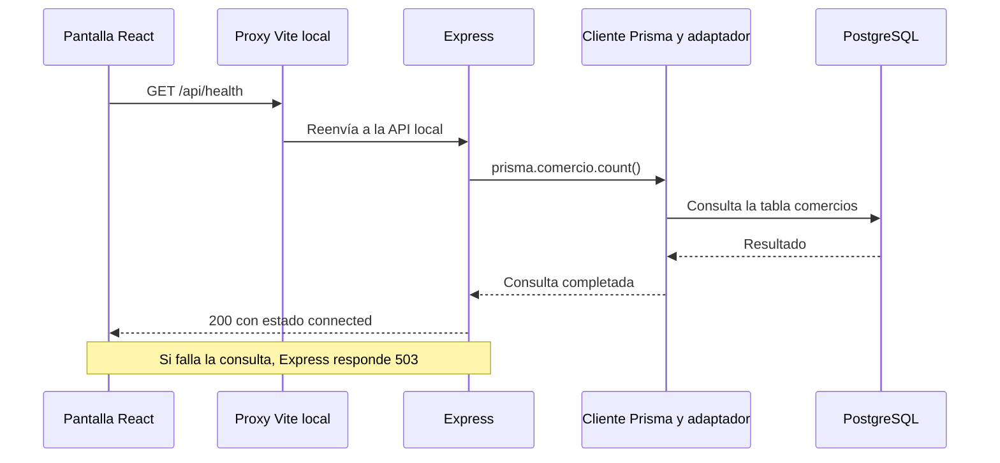

# Preparación de la defensa oral

Tomás Anchorena y Nazareno Romero · TFI de la Tecnicatura Universitaria en Programación, UTN.

Documento de estudio compartido. Creado el 06/11/2026. La defensa será individual y cada integrante deberá explicar tanto su participación como el trabajo del compañero y el funcionamiento general del proyecto.

## Cómo estudiar y mantener esta guía

Primero leer el problema y el recorrido general. Después estudiar una etapa junto con sus archivos. Al terminar, intentar responder las preguntas sin mirar y mostrar en el código dónde ocurre lo explicado. Si una respuesta todavía cuesta, anotarla como pendiente de practicar.

Las etapas 0 y 1 se explican a partir del código local y los registros de ejecución de octubre. La etapa 1 está cerrada por el equipo. Nazareno informó la implementación de la etapa 2 en `etapa-2-acceso`; su explicación y revisión se incorporarán cuando se consulte esa versión. Las explicaciones sobre futuras funciones se identifican como diseño previsto.

Los ejemplos orales son una guía para practicar. Cada integrante debe ajustarlos a las tareas que realmente realizó. El registro de participación permite identificar responsables y evidencias. [Registro de participación](docs/participacion-y-defensa.md).

### Índice de estudio

- [El proyecto y las palabras básicas](#el-proyecto-y-las-palabras-básicas)
- [Etapa 0 — Organización y alcance](#etapa-0--organización-y-alcance)
- [Etapa 1 — Entorno y recorrido completo de conexión](#etapa-1--entorno-y-recorrido-completo-de-conexión)
- [Etapa 1 — Base de datos y reglas](#etapa-1--base-de-datos-y-reglas)
- [Etapa 1 — Seed y contraseñas](#etapa-1--seed-y-contraseñas)
- [Etapa 1 — Configuración, errores y pruebas](#etapa-1--configuración-errores-y-pruebas)
- [Etapa 1 — Aportes y práctica oral](#etapa-1--aportes-y-práctica-oral)
- [Etapas siguientes](#etapas-siguientes)
- [Acuerdo para ampliar esta guía](#acuerdo-para-ampliar-esta-guía)

## El proyecto y las palabras básicas

### Qué problema queremos resolver

Un comercio chico necesita saber qué tiene, qué entró, qué salió y qué debería reponer. Llevarlo en una libreta o en mensajes separados dificulta consultar el saldo y reconstruir un error. Stock Manager reúne productos, movimientos y faltantes en una aplicación web.

El MVP, o primera versión con el alcance comprometido, contempla catálogo, ingresos y egresos, alertas y listas de reposición por proveedor. El dueño administra el catálogo, realiza ajustes y prepara reposición. El empleado consulta y registra operaciones habituales. Facturación fiscal, pagos, registro público de comercios y seguimiento de órdenes quedan fuera del alcance aprobado. Así concentramos el desarrollo en inventario y reposición.

Un ejemplo del funcionamiento previsto es cargar harina, registrar su salida, detectar que quedó por debajo del mínimo y preparar una lista para el proveedor. La recepción de esa mercadería se registra luego como un ingreso. Las reglas completas están documentadas por separado. [Requerimientos](docs/segunda_entrega/01-requerimientos.md), [reglas de negocio](docs/segunda_entrega/02-reglas-de-negocio.md).

### Qué hace cada parte

| Concepto | Explicación aplicada al proyecto |
|---|---|
| Frontend | La parte que se ve y utiliza en el navegador. Muestra pantallas, recibe datos y comunica resultados. Usamos React. |
| Backend | El programa que recibe solicitudes, controla reglas y consulta o modifica la base. Usamos Node.js y Express. |
| Base de datos | Guarda información de manera persistente y aplica restricciones. Usamos PostgreSQL. |
| API | El conjunto de operaciones que el backend ofrece para que la interfaz se comunique con él. |
| HTTP | El protocolo de solicitudes y respuestas entre navegador y servidor. |
| Endpoint | Una operación de la API identificada por método y ruta, como `GET /api/health`. |
| GET | Método HTTP que usamos para consultar. En la etapa 1 consulta disponibilidad. |
| JSON | Formato de texto para intercambiar datos estructurados, por ejemplo `{ "status": "ok" }`. |
| ORM | Herramienta para trabajar con tablas mediante objetos y métodos del lenguaje. Prisma es el ORM elegido. |
| SQL | Lenguaje de PostgreSQL para definir estructuras, consultar y modificar datos. Aparece directamente en migraciones y algunas pruebas. |
| Módulo | Parte del código con una responsabilidad, como acceso, catálogo o inventario. |
| Dependencia | Paquete de código externo que usamos, como Express o React. npm los instala. |
| Entorno | Configuración y servicios donde corre la app. Distinguimos desarrollo, pruebas y producción. |

El frontend necesita al backend para aplicar reglas sobre datos compartidos. El backend accede a PostgreSQL mediante Prisma. Las credenciales de PostgreSQL se configuran en el servidor. Un navegador siempre puede enviar solicitudes modificadas, por lo que los controles decisivos de permisos y negocio deben estar también en el backend.

## Etapa 0 — Organización y alcance

### Qué hicimos y por qué

Partimos de la propuesta y el diseño aprobados. Antes de implementar, ordenamos el trabajo en etapas con un resultado observable y pruebas asociadas. Cada función se desarrollará con su pantalla, validación y persistencia para poder probar un recorrido concreto. Esta organización ayuda a detectar errores antes de construir módulos que dependan de ellos.

El orden responde a dependencias. Acceso identifica quién opera; catálogo define sobre qué productos se opera; inventario registra movimientos; alertas y reposición usan los saldos. Después verificamos el conjunto, completamos el despliegue y realizamos el piloto y la entrega. La hoja de ruta detalla las tareas y los criterios de cierre. [Plan de desarrollo](docs/plan-desarrollo.md).

### Cómo nos repartimos

| Etapa | Coordinación e implementación asistida | Revisión |
|---|---|---|
| 1. Entorno y base | Tomás con Codex | Nazareno con Claude |
| 2. Acceso y permisos | Nazareno con Claude | Tomás con Codex |
| 3. Catálogo | Tomás con Codex | Nazareno con Claude |
| 4. Movimientos e historial | Nazareno con Claude | Tomás con Codex |
| 5. Alertas y reposición | Tomás con Codex | Nazareno con Claude |
| 6. Verificación y despliegue | Ambos, tareas por concretar | Cruzada |
| 7. Piloto, documentación y entrega | Ambos, tareas por concretar | Cruzada |

Este reparto se acordó el 04/11. La etapa 0 corresponde a la organización compartida. El código se produce con asistencia de IA. El aporte de cada estudiante se registra mediante las decisiones, coordinación, verificaciones y revisiones que efectivamente realice. Ambos tienen que aprender a explicar el resultado y sus límites.

La revisión se hace sobre una versión identificable. El responsable comparte el trabajo, el compañero revisa con su asistente y las observaciones se resuelven antes de continuar con una etapa dependiente. La revisión puede detectar un error, proponer una mejora o confirmar que una decisión está justificada. Se conserva el motivo de la resolución.

### Qué significa compartir una versión

Git registra cambios del proyecto. Un **commit** guarda una versión local con un identificador. **Push** la envía al repositorio remoto. **Fetch** actualiza la información que tenemos de ese remoto. **Pull** trae e integra sus cambios en la rama local. Una **rama** permite desarrollar una línea de trabajo, como `etapa-2-acceso`, para revisarla antes de unirla con `main` mediante una integración o merge.

Los archivos sin commit en la computadora de un integrante todavía no se obtienen desde el remoto. Por eso para revisar una etapa necesitamos que esté compartida y saber la rama y el commit. Los comandos de Git quedan a cargo de los integrantes por el acuerdo de trabajo.

### Qué quedó pendiente al preparar el proyecto

Se dejaron identificadas la coordinación del comercio piloto y la elección de cuentas y servicios para publicar. Son decisiones externas al código. Se pueden desarrollar y probar funciones locales mientras se resuelven, pero la prueba online y el piloto deben verificarse en sus entornos reales.

**Pregunta para practicar:** ¿por qué dividieron el trabajo por etapas?

**Respuesta orientativa:** «Porque los módulos dependen entre sí. Primero verificamos la conexión y la estructura de datos, luego quién puede operar, después productos y movimientos, y finalmente los faltantes. En cada paso dejamos pruebas y una revisión del compañero para detectar problemas antes de seguir».

## Etapa 1 — Entorno y recorrido completo de conexión

### Qué quedó funcionando

La etapa 1 construyó una aplicación mínima ejecutable. Al abrir la pantalla, React consulta el backend. Express realiza una consulta real a PostgreSQL usando Prisma y devuelve un estado. React muestra conexión correcta o un error con posibilidad de reintentar.

Además quedaron el esquema operativo, la migración inicial, los datos ficticios repetibles, validaciones compartidas y pruebas. El login y las operaciones de catálogo e inventario corresponden a las etapas siguientes. Los nombres de esos módulos en la pantalla inicial anuncian el trabajo previsto. [Informe de etapa 1](docs/implementacion/etapa-1.md).

### Por qué usamos este stack

Estas tecnologías ya formaban parte de la propuesta. La etapa 1 concretó su configuración y comprobó que trabajan juntas.

| Elección | Motivo aplicado al proyecto y costo que asumimos |
|---|---|
| React | Permite organizar pantallas en componentes y actualizarlas cuando cambia su estado. Hay que aprender cómo se manejan estado y efectos. |
| Node.js + Express | Permite escribir el servidor en JavaScript y definir rutas y controles comunes. Las reglas del negocio y los permisos deben implementarse explícitamente. |
| PostgreSQL | El proyecto tiene entidades relacionadas y necesita restricciones y transacciones para conservar saldos e historial coherentes. Requiere diseñar y mantener el esquema. |
| Prisma | Ofrece un cliente generado desde el modelo y herramientas de migración. Algunas restricciones se agregan mediante SQL, y las reglas de negocio siguen requiriendo código. |
| JavaScript con módulos ES | Mantiene el lenguaje previsto del backend. `import` y `export` permiten repartir responsabilidades entre archivos. |
| tsx | Ejecuta nuestro JavaScript y el TypeScript del cliente generado de Prisma elegido. Evita un paso separado de compilación del servidor en este montaje y agrega una dependencia de ejecución. |
| Vite | Da un servidor de desarrollo para React y genera los archivos del frontend para publicar. La compilación de frontend sigue siendo necesaria. |
| npm workspaces | Organiza frontend y backend dentro del mismo repositorio con una instalación y un lockfile compartidos. |

Las versiones que se instalaron y probaron en esta etapa fueron Node 24.22.1, Prisma/cliente/adaptador 7.10.1, Express 5.3.0, React 19.3.1, Vite 8.3.5 y tsx 4.23.15. La decisión busca repetir el entorno comprobado. `package-lock.json` registra también las dependencias indirectas. `npm ci` instala según ese archivo.

`.nvmrc` y `.node-version` indican Node 24.22.1 como versión recomendada. El rango de `engines` es `>=24.22.1 <25`, y `.npmrc` activa su control estricto. Las versiones 24.x posteriores al mínimo entran en ese rango. tsx también tiene requisitos de compatibilidad, de modo que el equipo usa el entorno probado. [Comandos y workspaces](package.json), [dependencias del backend](backend/package.json), [dependencias del frontend](frontend/package.json).

### Cómo se organiza el código

| Archivo o carpeta | Qué buscar al estudiar |
|---|---|
| `frontend/src/main.jsx` | Monta el componente principal dentro del HTML y carga estilos. |
| `frontend/src/app/App.jsx` | Describe la pantalla y cambia entre comprobando, conectado y error. |
| `frontend/src/services/api.js` | Envía la solicitud de disponibilidad y verifica la respuesta. |
| `backend/src/app.js` | Define la aplicación Express, sus controles comunes y sus rutas. |
| `backend/src/server.js` | Lee configuración, crea Prisma, abre el puerto y gestiona el cierre. |
| `backend/src/lib/` | Funciones compartidas de configuración, Prisma, validación y diagnóstico. |
| `backend/prisma/` | Modelo, migraciones y seed. |
| `backend/tests/` | Pruebas de lógica, HTTP e integración con base real. |
| `docs/` | Diseño, plan, evidencias y registro de participación. |

Separar `app.js` de `server.js` permite probar la aplicación con una dependencia controlada. `createApp({ prisma })` recibe el cliente a utilizar. Una prueba de HTTP puede pasar una simulación, mientras que una de integración pasa el cliente conectado a PostgreSQL. Esto se llama **inyección de dependencias**: entregar a una función lo que necesita desde afuera.

### El recorrido de una solicitud

1. El navegador carga la página y `main.jsx` monta `App`.
2. `App` empieza en estado `loading`. Un efecto de React ejecuta `checkHealth`.
3. `checkHealth` hace una solicitud mediante `fetch`. En desarrollo la ruta `/api` pasa por el proxy de Vite hasta Express, normalmente en el puerto 3001.
4. La ruta de Express espera `prisma.comercio.count()`.
5. Prisma consulta PostgreSQL. Si puede contar la tabla, Express responde `{ "status": "ok", "database": "connected" }`.
6. La interfaz verifica tanto el estado HTTP como el contenido esperado. Entonces muestra «La conexión está lista».

Contar comercios comprueba conexión y acceso a una tabla del modelo. Una tabla vacía devuelve cero y también cuenta como disponibilidad correcta. Este chequeo demuestra ese recorrido, mientras que la integridad del resto del esquema y las funciones se comprueba mediante pruebas específicas.

La ruta es pública para consultar disponibilidad. La respuesta expone solo estados. Esto permite mostrar un diagnóstico inicial sin devolver información de comercios ni credenciales. [Aplicación Express](backend/src/app.js), [servicio del frontend](frontend/src/services/api.js).

### Qué significan las instrucciones que vemos

En `await prisma.comercio.count()`, `prisma` es el cliente, `comercio` es el modelo y `count()` es la operación de contar. `await` espera que termine una operación asíncrona, que devuelve una promesa. El servidor puede atender otros eventos mientras espera la respuesta de la base.

`try` contiene una operación que puede fallar. `catch` recibe el error. En esta ruta, una consulta exitosa lleva a HTTP 200 y una fallida a HTTP 503. El `catch` también deja un diagnóstico controlado para investigar el problema.

En React, **estado** es información que puede cambiar y hacer que la pantalla se vuelva a dibujar. `useState` mantiene el estado de conexión y el número de intento. `useEffect` ejecuta la consulta al cargar y al cambiar ese intento. El botón incrementa el intento para volver a consultar.

Se usa `AbortController` para cancelar la espera de la solicitud, con un plazo de ocho segundos. Al desmontar el componente se limpia el temporizador y se cancela la solicitud. La variable `active` evita que una respuesta vieja cambie el estado después de esa limpieza. El botón queda deshabilitado durante la consulta para evitar reintentos superpuestos desde ese control. Los ocho segundos son un límite elegido para esta pantalla, no una medición del rendimiento del sistema.

La interfaz incluye estados de carga y error, adaptación a móvil y avisos con `aria-live` para tecnologías de asistencia. Son detalles que permiten entender qué está ocurriendo incluso si la base no responde. [Pantalla de conexión](frontend/src/app/App.jsx), [estilos](frontend/src/app/styles.css).

### Prisma, el cliente generado y el adaptador

El `schema.prisma` declara modelos y tipos. `prisma generate` lee ese esquema y produce el cliente en `backend/src/generated/prisma`. El generador elegido produce TypeScript, que ejecutamos con tsx. El programa importa ese cliente y crea un adaptador `PrismaPg` con la conexión a PostgreSQL.

El cliente ofrece métodos como `findUnique`, `create`, `count` y `$transaction`. El adaptador conecta ese acceso con el controlador de PostgreSQL. El esquema declara `provider = "postgresql"`; en esta configuración de Prisma 7 la URL para los comandos está en `prisma.config.ts`. La aplicación configura su adaptador desde la variable de entorno.

El cliente generado debe regenerarse cuando cambia el esquema. Editar los archivos generados a mano perdería los cambios en la siguiente generación. Por eso se conserva el esquema y se excluye esa salida del repositorio.

En el adaptador se eligió un máximo de cinco conexiones, cinco segundos de espera de conexión y diez de inactividad. Son parámetros iniciales acotados para este entorno. Una conexión permite enviar consultas; mantener un grupo reutilizable evita abrir una nueva para cada operación. Ajustar esos números requerirá observar la carga y los límites del alojamiento. [Creación de Prisma](backend/src/lib/prisma.js), [configuración del CLI](backend/prisma.config.ts).

## Etapa 1 — Base de datos y reglas

### Qué parte viene del diseño aprobado

El modelo ya se había trabajado en la segunda entrega. En la etapa 1 lo llevamos al esquema operativo y a una migración ejecutable. La copia de `docs/segunda_entrega` conserva el antecedente presentado. El archivo que guía la implementación está en `backend/prisma/schema.prisma`. [Modelo operativo](backend/prisma/schema.prisma).

### Las seis entidades

Una tabla contiene filas, y cada fila representa un registro. Una columna representa un atributo, como el nombre. La **clave primaria** identifica una fila. Una **clave foránea** referencia una fila de otra tabla.

| Entidad | Qué representa y con qué se relaciona |
|---|---|
| Comercio | El negocio al que pertenecen usuarios y catálogo. Es la separación principal de datos. |
| Usuario | Una persona con correo, hash de contraseña, rol, estado y comercio. Sus movimientos conservan quién los registró. |
| Categoria | Agrupa productos dentro de un comercio. Tiene nombre visible y normalizado. |
| Proveedor | Destinatario de reposición, con datos de contacto opcionales. Cada producto tiene un proveedor principal. |
| Producto | Código, nombre, unidad, saldo, mínimo, objetivo y referencias a comercio, categoría y proveedor. |
| MovimientoStock | Un ingreso o egreso con cantidad positiva, motivo, responsable, producto, fecha y observación cuando corresponde. |

Los identificadores usan UUID, un formato amplio de identificación que no depende de numerar registros consecutivamente. Conocer un UUID sigue requiriendo autorización para acceder a su registro. `@@map` y `@map` vinculan los nombres del código, como `MovimientoStock` o `comercioId`, con nombres SQL como `movimientos_stock` y `comercio_id`.

Los tipos enumerados restringen valores, por ejemplo `DUENO`/`EMPLEADO`, `UNIDAD`/`KG` e `INGRESO`/`EGRESO`. Los campos de texto tienen longitudes máximas. Las fechas usan `Timestamptz(3)` para registrar instantes con precisión de milisegundos y tratarlos según zona horaria al mostrarlos. Los valores por defecto se asignan al crear registros según el esquema y la migración.

### Relaciones e integridad referencial

Un producto pertenece a un comercio, una categoría y un proveedor. Un movimiento pertenece a un producto y a un usuario. Las claves foráneas impiden referencias a registros inexistentes. `onDelete: Restrict` rechaza el borrado físico de un registro que todavía tiene referencias. Para conservar historia, el diseño del catálogo utiliza baja lógica mediante `activo`.

La relación simple con una categoría comprueba que exista. Que además sea del mismo comercio es una regla que el backend debe validar. Lo mismo vale para el proveedor del producto y el usuario de un movimiento. La etapa 1 crea la estructura y los datos coherentes del seed; los controles de acceso y de operaciones se incorporan en las etapas correspondientes.

`MovimientoStock` obtiene el comercio a través de su producto. Esto evita guardar un comercio adicional que podría contradecir al del producto. Las consultas futuras de historial deberán filtrar por esa relación. El criterio de separación por comercio se llama **multi-tenant**: una aplicación sirve a varios negocios, manteniendo sus datos y accesos separados.

### Unicidad e índices

`correo` identifica una cuenta de manera global. El código del producto es único dentro de su comercio. Por eso A y B pueden usar `HAR001`, pero A no puede duplicarlo. Categoría y proveedor tienen unicidad por comercio y nombre normalizado.

Un índice ayuda a encontrar filas por determinados campos. Hay índices para consultar usuarios por comercio, productos por comercio/actividad y movimientos por producto/fecha, entre otros. Un índice único además impide duplicados. Los índices consumen espacio y requieren mantenimiento cuando se escribe, por lo que se eligieron según consultas y restricciones previstas, sin afirmar mejoras de rendimiento medidas.

### Por qué guardamos dos versiones del nombre

Queremos mostrar el nombre con sus mayúsculas y tildes, y al mismo tiempo impedir duplicados por diferencias de espacios o mayúsculas. `normalizeName` devuelve el nombre visible y su versión normalizada en minúsculas.

Por ejemplo, `  ALIMENTOS   Secos ` se muestra como `ALIMENTOS Secos` y tiene `alimentos secos` como valor normalizado. La función recorta extremos, reduce espacios repetidos y utiliza Unicode NFC, que unifica representaciones equivalentes de un carácter. Conserva tildes, de modo que `Almacén` y `Almacen` siguen siendo nombres distintos.

Se eligió una columna con un índice único compuesto porque podemos declararla directamente en Prisma. Otra alternativa considerada es un índice SQL sobre una expresión de normalización. Esa opción requiere administrar SQL adicional. Nuestra elección exige calcular y guardar ambos campos juntos desde código compartido, incluido el seed. [Normalización y cantidades](backend/src/lib/validation.js).

### Cómo explicar la normalización del modelo

Normalizar una base busca organizar dependencias para reducir inconsistencias al insertar, actualizar o eliminar datos. Una **clave candidata** es cualquier conjunto mínimo de campos capaz de identificar una fila. Elegimos una como primaria. Una **superclave** identifica la fila y puede contener campos de más. Un atributo **primo** pertenece a alguna clave candidata.

La primera forma normal exige valores atómicos respecto del modelo y una estructura tabular sin grupos repetidos. La segunda exige que los atributos no primos dependan de la totalidad de cada clave candidata. Para tercera forma normal, en cada dependencia no trivial `X → A`, X debe ser superclave o A debe ser primo. FNBC exige siempre que X sea superclave.

El diseño documenta 3FN bajo las reglas del negocio, con excepciones a FNBC en categorías, proveedores y productos. En categorías, `nombre → nombre_normalizado`, pero un nombre puede repetirse entre comercios. Cumple la condición de 3FN porque el normalizado participa en la clave candidata `(comercio_id, nombre_normalizado)`. En productos, la categoría determina el comercio según RN-01. `comercio_id` participa en la clave candidata `(comercio_id, codigo)`, aunque una categoría por sí sola no identifica un producto.

De esa regla también se deduce que `(categoria_id, codigo)` identifica un producto: la categoría fija el comercio y el código es único dentro de él. El mismo razonamiento sirve para proveedor y código. Estas claves inferidas dependen de que se respeten las asociaciones de comercio. Las restricciones SQL simples no garantizan todas esas reglas por sí solas. Estudiar la tabla completa de claves y dependencias si preguntan por la justificación formal. [Normalización presentada](docs/segunda_entrega/03-modelo-de-datos.md#normalización-del-modelo).

### Por qué el stock usa decimales exactos

Una dietética vende fracciones de kg. PostgreSQL guarda cantidades como `NUMERIC(12,3)`: doce dígitos totales, de los cuales tres son decimales. El máximo positivo es `999999999.999`. Para `UNIDAD`, las cantidades deben representar enteros. `2.000` representa dos unidades; `2.500` representa dos y media y se rechaza para esa unidad.

En JavaScript, los números habituales usan una representación binaria que puede aproximar fracciones decimales. Elegimos `Prisma.Decimal` y un contrato de API con cadenas, como `"0.250"`, para conservar el valor exacto. `parseQuantity` comprueba el formato y crea el decimal. Rechaza precisión excesiva, negativos, notación científica y cero salvo habilitación explícita para campos que lo admiten.

El formato visible puede utilizar coma decimal, pero el contrato interno utiliza punto. Son dos cuestiones distintas: representar una cantidad para la persona y transportarla entre programas. Los módulos futuros deben aplicar estas funciones y validar también el resultado de las operaciones para que entre en el rango.

### Stock actual, historial, mínimo y objetivo

El **stock actual** es el saldo. El **mínimo** indica cuándo alertar. El **objetivo** orienta cuánto reponer. Con actual 3, mínimo 5 y objetivo 12, la regla prevista alerta y sugiere 9. La igualdad con el mínimo no alerta, y un mínimo cero desactiva la alerta del producto.

El saldo puede calcularse sumando ingresos y restando egresos. Aun así, lo almacenamos en Producto como **desnormalización deliberada**, una copia resumida de un agregado del historial. Esto permite comprobar y actualizar el saldo en una fila, además de consultar alertas directamente. Su costo es mantener saldo e historial consistentes en cada movimiento.

La estrategia prevista es una transacción que valida y bloquea el producto, actualiza el saldo de forma condicional y guarda el movimiento. Si falla una parte, se revierte todo. Con saldo 3 y dos egresos simultáneos de 3, solo uno debe confirmarse. Ese comportamiento se implementará y probará en inventario. Calcular el saldo desde el historial también puede hacerse correctamente usando coordinación de concurrencia; almacenar el saldo es la estrategia elegida, no la única solución posible.

No se midió una ganancia de rendimiento por almacenar el saldo. El análisis de 3FN anterior estudia dependencias dentro de cada relación; la materialización del agregado entre tablas se explica adicionalmente como una decisión de consistencia. [Justificación de stock actual](docs/segunda_entrega/03-modelo-de-datos.md#stock-actual-como-desnormalización-deliberada).

### Qué es una transacción y qué significa ACID

Una transacción agrupa operaciones que deben confirmarse o revertirse juntas. **Atomicidad** significa que se confirma el conjunto completo. **Consistencia** significa que se preservan las reglas e invariantes que implementamos. **Aislamiento** controla cómo interactúan operaciones concurrentes según la configuración y los bloqueos. **Durabilidad** significa que una confirmación queda persistida conforme a las garantías del sistema de base.

PostgreSQL proporciona mecanismos transaccionales, pero las reglas y la estrategia de concurrencia deben diseñarse correctamente. En la etapa 1 se usa una transacción en el seed y se prueba un rollback real. La operación completa de movimiento corresponde a etapas posteriores.

### Las siete restricciones CHECK

Un CHECK es una condición que PostgreSQL exige al insertar o modificar una fila. Complementa las validaciones del servidor, incluso cuando una escritura se realiza directamente en la base.

| Restricción de la migración | Qué exige y ejemplo |
|---|---|
| `productos_stock_actual_no_negativo` | Saldo mayor o igual a cero. Rechaza -1. |
| `productos_stock_minimo_no_negativo` | Mínimo mayor o igual a cero. |
| `productos_objetivo_alcanza_minimo` | Objetivo mayor o igual al mínimo. Rechaza objetivo 4 con mínimo 5. |
| `productos_cantidades_enteras_por_unidad` | En UNIDAD, saldo, mínimo y objetivo representan enteros. |
| `movimientos_cantidad_positiva` | Todo movimiento tiene cantidad mayor a cero. El tipo determina si suma o resta. |
| `movimientos_tipo_motivo_valido` | Stock inicial y reposición son ingresos, salida es egreso y ajuste permite ambos tipos. |
| `movimientos_ajuste_con_observacion` | Un ajuste requiere observación con algún carácter distinto de espacio. |

Los CHECK se agregaron mediante SQL en la migración. El CHECK de cantidades enteras del producto puede consultar la unidad porque está en la misma fila. El movimiento referencia la unidad a través del producto, de modo que esa validación queda en el backend según el diseño. Los permisos por rol también corresponden a la aplicación. [Migración y restricciones](backend/prisma/migrations/202610280001_initial/migration.sql).

### Esquema, generación, migración y seed

| Elemento | Qué hace |
|---|---|
| Esquema Prisma | Describe modelos, campos y relaciones para Prisma. |
| `npm run generate` | Produce el cliente de código a partir del esquema. |
| Migración SQL | Crea o modifica estructuras y restricciones de PostgreSQL. |
| `npm run db:migrate` | Aplica las migraciones pendientes mediante `prisma migrate deploy`. |
| `npm run db:seed` | Carga registros ficticios iniciales sobre la estructura existente. |

La migración inicial se generó desde el esquema y se completó con los CHECK. Prisma registra su aplicación en `_prisma_migrations`. Por eso una segunda ejecución puede decir que no quedan migraciones pendientes.

Se conserva la migración aplicada, incluidos sus comentarios históricos, porque su contenido tiene un checksum o huella de integridad. Una modificación posterior del modelo se registra mediante una nueva migración. Incluso cambiar un comentario alteraría la huella del archivo inicial.

La migración inicial crea el esquema, pero una migración futura podría incluir operaciones que eliminen datos. Antes de aplicarla se debe revisar su contenido. Los CHECK ya incluidos no requieren volver a ejecutar el SQL histórico de la segunda entrega.

## Etapa 1 — Seed y contraseñas

### Qué datos carga y para qué

El seed crea dos comercios ficticios. Cada uno tiene dueño, empleado, una categoría y un proveedor. Los cuatro correos usan el dominio reservado de ejemplo `example.invalid`. Preparar dos comercios permite construir posteriormente pruebas de separación y contar con ambos roles desde el inicio. En esta etapa el seed deja el catálogo sin productos ni movimientos. [Datos del seed](backend/prisma/seed-data.js).

El seed utiliza IDs fijos para los comercios y búsquedas por claves únicas para las otras entidades. `upsert` significa crear si el registro no existe o usar la rama de actualización si ya existe. Aquí la actualización es vacía para conservar los datos existentes. Esto permite repetir la carga sin duplicar los registros de demostración.

Si una cuenta ya existe con otro comercio o rol, el seed rechaza la operación. Cambiar silenciosamente esa asociación podría alterar responsabilidades. Los registros se cargan dentro de una transacción para evitar un conjunto parcialmente creado. La generación de hashes ocurre antes de abrirla para reducir el tiempo que permanece abierta.

### Cómo se guardan las contraseñas

El archivo de entorno aporta las contraseñas de demostración. Antes de guardarlas se calcula un **hash** mediante bcrypt, con factor de costo 12. El costo aumenta el trabajo necesario para calcular y comprobar contraseñas. bcrypt incorpora sal, un valor aleatorio, por lo que dos hashes de la misma contraseña pueden diferir.

Para comprobar una contraseña se usa `bcrypt.compare`, que verifica la candidata contra el hash almacenado. La etapa 1 comprueba esto en las pruebas del seed; el recorrido de login se incorpora en la etapa 2. El hash se almacena en `password_hash`.

El seed exige al menos doce caracteres y como máximo 72 bytes UTF-8. El límite en bytes importa porque un carácter puede ocupar más de un byte y bcrypt tiene ese límite de entrada. Se evita aceptar una contraseña cuya parte final quede ignorada. El factor 12 y el mínimo son decisiones de esta implementación; no se presentan como requisitos literales de la tutora.

Repetir el seed conserva el hash de una cuenta existente. Por eso cambiar la contraseña del `.env` y repetir la carga no restablece una cuenta ya creada. Ese comportamiento se probó expresamente. Cualquier gestión posterior de credenciales debe ser una operación deliberada.

### Por qué requiere habilitación explícita

El comando de seed exige `ALLOW_DEMO_SEED=true` y rechaza siempre `NODE_ENV=production`. Se eligió esta habilitación para permitir entornos de desarrollo tanto locales como remotos y reducir cargas accidentales de datos ficticios. El equipo debe verificar la base configurada. La función interna `seedDemo` también se utiliza en pruebas controladas; el control de entorno está en la entrada del comando.

Los errores previstos distinguen producción, habilitación ausente, contraseña inválida y cuenta incompatible. El mensaje permite corregir la configuración sin imprimir contraseñas. Nazareno informó haber dejado la habilitación en `false` al terminar sus pruebas. [Entrada del seed](backend/prisma/seed.js), [controles y errores](backend/prisma/seed-errors.js).

## Etapa 1 — Configuración, errores y pruebas

### Variables de entorno y secretos

Una variable de entorno entrega configuración al proceso. `DATABASE_URL` indica cómo conectar a PostgreSQL, incluyendo servidor, puerto y base. `TEST_DATABASE_URL` identifica la base exclusiva de pruebas. `HOST`, `PORT` y `FRONTEND_ORIGIN` configuran la API. Las contraseñas del seed se obtienen de sus variables específicas.

`backend/.env` es un archivo local para cargar esas variables durante el desarrollo. `dotenv` lo lee usando una ruta relativa al archivo de código para evitar depender de dónde se abrió la terminal. `.env.example` muestra los nombres esperados. El `.env` real se excluye mediante `.gitignore`. También se excluyen dependencias instaladas, cliente generado y compilaciones que pueden reconstruirse.

La validación de configuración rechaza una URL de base mal formada, un puerto fuera de rango y un origen inválido. Los errores evitan imprimir el valor completo de la conexión. Validar formato permite fallar temprano, pero las credenciales y la conectividad se comprueban realmente al intentar consultar.

En el equipo de Nazareno se reportó un error de autenticación porque el archivo editado no se había guardado. Por eso las instrucciones indican guardar, cerrar y volver a abrir el `.env` exacto para verificarlo localmente. [Configuración](backend/src/lib/config.js), [carga del entorno](backend/src/lib/load-env.js), [ejemplo de variables](backend/.env.example).

### Desarrollo y publicación

En desarrollo, Vite sirve la interfaz en el puerto 5173 y reenvía `/api` a Express mediante un **proxy**. Un puerto identifica el servicio dentro de un equipo. `localhost` y `127.0.0.1` apuntan al propio equipo en esta configuración.

Para publicar, Vite genera `frontend/dist`. El frontend puede usar `VITE_API_URL` como URL pública del backend, incorporada durante la compilación. Variables del frontend expuestas mediante Vite son visibles para quien usa la página, por lo que las credenciales de base permanecen del lado del servidor.

`npm run dev` inicia ambos procesos mediante `concurrently`. `tsx watch` reinicia el backend ante cambios. `npm start` inicia la API con tsx. La publicación debe aplicar migraciones en el orden acordado y luego ejecutar la aplicación. Se documentaron alternativas para hacerlo según el proveedor. En el cierre de etapa 1 la configuración de despliegue está preparada y la verificación cloud sigue pendiente. [Configuración de Vite](frontend/vite.config.js), [plan de despliegue](docs/implementacion/despliegue.md).

### Controles comunes del servidor

Un **middleware** es una función que participa en el procesamiento de solicitudes de Express. Puede validar, agregar información, responder o continuar con el siguiente paso mediante `next`.

| Control | Motivo |
|---|---|
| `helmet()` | Configura encabezados HTTP de protección habituales. La autorización de negocio se implementa por separado. |
| CORS con un origen configurado | Indica a los navegadores qué origen puede leer respuestas de la API. La identidad del usuario requiere autenticación adicional. |
| JSON con límite de 32 KB | Acota el tamaño aceptado por este parser. Es una configuración inicial suficiente para los mensajes previstos en esta etapa. |
| `Cache-Control: no-store` | Solicita evitar guardar respuestas de la API en caché, para consultar estado vigente. |
| Desactivar `x-powered-by` | Evita publicar ese encabezado identificador del framework. |
| Cierre con SIGINT/SIGTERM | Al detener el proceso se cierra el servidor y se desconecta Prisma. Se fija un plazo máximo de diez segundos para ese cierre. |

### Cómo se comunican los errores

| Estado HTTP | Significado en la etapa 1 |
|---|---|
| 200 | Consulta de disponibilidad correcta. |
| 400 | Datos o JSON inválidos. |
| 404 | Ruta inexistente. |
| 413 | Cuerpo de solicitud demasiado grande. |
| 500 | Error interno inesperado. |
| 503 | La comprobación de la base no pudo completarse. |

El manejador común devuelve mensajes utilizables por la interfaz. Los fallos inesperados generan un diagnóstico con tipo, código reconocido y hasta cinco ubicaciones de archivo/línea. Se filtran mensajes internos, metadatos y datos de solicitudes porque podrían contener información sensible. Es un equilibrio entre poder investigar y controlar la información registrada.

Durante la revisión se mejoró este punto para evitar tanto ocultar todo el diagnóstico como registrar el error completo. Las pruebas comprueban que los datos sensibles de ejemplo no aparezcan en el registro. [Manejador de errores](backend/src/middlewares/error-handler.js), [diagnóstico controlado](backend/src/lib/error-details.js).

### Qué prueba cada tipo de test

Un test ejecuta un caso y compara lo ocurrido con un resultado esperado mediante una **aserción**. Por ejemplo, afirmar que una respuesta tenga estado 503. Una prueba negativa usa una entrada inválida para comprobar que el programa la rechace correctamente.

| Tipo | Ejemplo real de etapa 1 |
|---|---|
| Lógica | Normalizar espacios, aceptar kg fraccionarios o rechazar una cantidad inválida. |
| HTTP con dependencia simulada | Llamar a Express haciendo que el cliente de base simulado falle y comprobar su respuesta. |
| Integración con PostgreSQL | Aplicar migración, consultar tablas, ejecutar seed y comprobar rollback o rechazo por CHECK. |
| Navegador | Mostrar conexión, simular 503, reintentar y revisar la pantalla móvil. |
| Instalación nueva | Partir de dependencias y bases preparadas desde cero y seguir los comandos del README. |

Una simulación o mock permite controlar un caso concreto, como la caída de la base. La integración verifica componentes reales trabajando juntos. Por eso se usan ambos. Probar un recorrido desde la interfaz agrega la comprobación de lo que ve y hace la persona.

### Cómo protegemos los datos al probar

El comando de integración exige una base llamada `stock_manager_test`, esquema `public`, y compara su identidad con la base de desarrollo. Trata `localhost` y `127.0.0.1` como el mismo host para esa comprobación. Si falta la variable de prueba, se detiene.

Antes de migrar, consulta el catálogo de PostgreSQL para detectar relaciones ajenas al proyecto y comprueba si las tablas de negocio tienen datos. Rechaza esas situaciones antes de aplicar migraciones. El registro `_prisma_migrations` se admite para poder repetir pruebas sobre una estructura ya instalada.

Luego migra y ejecuta los tests. Los **fixtures** son los datos creados para probar. Los tests vuelven a comprobar que las tablas estén vacías y limpian sus fixtures al terminar. Se trabaja con una base exclusiva y una ejecución por vez. Si una interrupción deja restos, el README indica cómo inspeccionar y recuperar esa base descartable. Esta protección evita que una ejecución de pruebas empiece borrando datos desconocidos. [Identificación de la base](backend/tests/test-database.js), [inspección previa](backend/tests/preflight-database.js), [ejecutor de integración](backend/tests/run-integration.js).

### Cinco pruebas de integración que tenemos que saber explicar

1. **Estructura.** Consulta PostgreSQL y comprueba seis tablas de negocio y siete CHECK validados.
2. **Seed repetido.** Ejecuta dos cargas, comprueba cantidades de registros, relaciones en dos comercios, hash válido y conservación de contraseña existente.
3. **Rollback.** Crea y lee un comercio dentro de una transacción y provoca un error. Después comprueba que el comercio temporal no quedó guardado.
4. **Restricción de stock.** Intenta crear un producto con stock -1. Exige que falle por `productos_stock_actual_no_negativo`, porque un fallo distinto podría ocultar un problema del test.
5. **HTTP con base real.** Inicia Express con Prisma real, llama `/api/health` y comprueba la respuesta esperada.

Estas pruebas demuestran las propiedades que ejercitan. Las carreras entre movimientos, los permisos de endpoints de negocio y el funcionamiento completo de la reposición requieren sus propias pruebas al implementar esos módulos. [Pruebas de integración](backend/tests/integration/database.test.js).

### Resultados registrados y correcciones de la revisión

| Momento | Qué quedó registrado |
|---|---|
| 28/10, versión inicial | 8 pruebas de lógica/HTTP y 5 de integración, compilación y comprobaciones de navegador. |
| 29/10, correcciones | 14 de lógica/HTTP y 5 de integración. Nueva instalación, migraciones iniciales, rechazos del seed, protección previa a migrar y compilación. |
| 30/10, equipo de Nazareno | Migración inicial, seed dos veces, 14 de lógica/HTTP, 5 de integración en dos ejecuciones y build. Captura de conexión lista. |

El total de la batería final de etapa 1 es 19 pruebas. Repetirla verifica repetibilidad y no agrega casos nuevos al conteo. Los 32 casos SQL de septiembre pertenecen a la evidencia de la segunda entrega.

En una primera ejecución del 29/10 falló la lectura de un tipo interno del catálogo de PostgreSQL desde Prisma, con código `P2010`. Se corrigió convirtiendo los campos consultados a `text` y se repitió el ensayo con una copia y bases nuevas. Se conservaron ambas salidas, identificando cuál falló y cuál verificó la corrección.

También se mejoraron los mensajes del seed, el diagnóstico, la habilitación explícita, la inspección anterior a las migraciones, la comprobación del CHECK específico y la legibilidad. El valor de la revisión fue resolver comportamientos concretos y volver a comprobarlos.

La evidencia de Nazareno corresponde al commit `501810c` según el archivo enviado. El TXT contiene migración, seed, tests y build. Su cabecera informa que la instalación de dependencias, la creación de bases y el arranque también funcionaron, aunque esas salidas no se conservaron. La captura complementa el arranque. Esta precisión permite explicar qué fue observado en cada registro. [Revisión y evidencias del 29/10](docs/implementacion/revision-etapa-1.md), [salida de Nazareno](docs/implementacion/instalacion-nazareno-2026-10-30.txt), [captura de Nazareno](docs/implementacion/instalacion-nazareno-2026-10-30.png).

## Etapa 1 — Aportes y práctica oral

### Qué hizo cada integrante según el registro

**Tomás** llevó adelante la etapa con Codex, coordinó el alcance y la revisión entre asistentes, ejecutó los pasos de Git compartidos en la conversación y organizó la incorporación del trabajo. Codex produjo la implementación, las correcciones y las comprobaciones locales registradas. Tomás debe poder explicar el recorrido y las decisiones para defender esa parte.

**Nazareno** coordinó la revisión con Claude, aportó las observaciones y la instalación en su equipo con resultados y captura. Su reporte identifica los comandos ejecutados. La división exacta entre comandos tecleados personalmente y ejecutados por su asistente se completará según lo que él confirme.

Ambos participaron en el acuerdo de alcance y reparto mediante los intercambios compartidos. El registro detallado debe ampliarse con hechos concretos cuando se conozcan, manteniendo identificada la asistencia de IA. [Participación del equipo](docs/participacion-y-defensa.md#etapa-1--registro-inicial).

### Una explicación de un minuto para practicar

«En la primera etapa dejamos armado el entorno y comprobamos la comunicación entre la pantalla, el servidor y PostgreSQL. La pantalla React llama a una ruta de Express, que consulta la tabla de comercios con Prisma y devuelve el estado. También dejamos una migración que reconstruye la base con sus restricciones y un seed repetible de dos comercios para probar roles y separación. Usamos una base exclusiva para los tests y controles que revisan que esté vacía antes de migrar. La revisión agregó protecciones y mejoró los errores. Después comprobamos la instalación en ambos equipos».

Luego cada integrante agrega su aporte personal y el del compañero, según la sección anterior.

### Preguntas que pueden hacer y cómo razonarlas

**¿Dónde se ejecuta React y dónde Express?** React se ejecuta en el navegador. Express se ejecuta en el proceso Node del servidor. Aunque en desarrollo estén en la misma computadora, son partes separadas que se comunican por HTTP.

**¿Qué comprueba “La conexión está lista”?** Que el navegador pudo consultar la ruta y el servidor pudo consultar la tabla de comercios con la respuesta esperada. Las demás funciones se verifican con sus recorridos y pruebas.

**¿Dónde está la regla de stock no negativo?** Hay un CHECK en la migración. La futura lógica de egresos también debe verificar saldo y actualizarlo en una transacción. El CHECK constituye una protección de la base ante escrituras inválidas.

**¿Prisma reemplaza PostgreSQL?** Prisma ofrece el cliente y herramientas para trabajar con la base. PostgreSQL sigue siendo el sistema que guarda datos y aplica restricciones y transacciones.

**¿Por qué tsx si escribimos JavaScript?** El generador Prisma elegido produce TypeScript. tsx permite ejecutarlo junto con el JavaScript del servidor y se utiliza también al iniciar el backend publicado.

**¿Qué pasa si cambio el esquema y ejecuto solo generate?** Se actualiza el cliente generado. El cambio de estructura en PostgreSQL necesita una migración correspondiente.

**¿Por qué dos comercios de prueba?** Permiten preparar casos donde un usuario pertenece al comercio A y el recurso al B. Esos casos comprobarán que la autorización respeta el comercio.

**¿Una FK garantiza que categoría y producto sean del mismo comercio?** La FK simple garantiza la existencia de la categoría. La aplicación también debe validar su pertenencia al comercio según RN-01.

**¿Por qué guardamos stock si se puede calcular?** Elegimos mantener el saldo en la fila del producto para comprobarlo y actualizarlo durante operaciones transaccionales y consultarlo directamente. Asumimos la obligación de conciliarlo con el historial.

**¿Qué pasa si se corta una operación?** Las escrituras agrupadas en una transacción se confirman juntas o se revierten. La forma concreta de manejar concurrencia también debe implementarse. En esta etapa probamos un rollback real de un registro temporal.

**¿Por qué no guardar la contraseña directamente?** Guardamos una representación de verificación mediante bcrypt. Al verificar una candidata usamos `compare`; exponer la base no entrega directamente el texto original, aunque sigue siendo necesario proteger los hashes y las credenciales.

**¿Por qué una segunda carga del seed no cambia la contraseña?** La actualización de registros existentes se deja vacía. Así el comando de demostración no restablece cuentas al repetirse. Hay un test que verifica la conservación del hash.

**¿Qué significa que un test pasó?** Que para sus entradas y condiciones se cumplieron sus aserciones. Debemos explicar qué caso cubre y cuáles requieren otras pruebas.

**¿Qué hace CORS?** Controla en el navegador el acceso a respuestas entre orígenes. La autorización de usuarios y comercios debe comprobarse en el servidor aunque una solicitud llegue por otro cliente.

**¿Qué aprendieron de la revisión cruzada?** Por ejemplo, que revisar la base de pruebas después de migrar era demasiado tarde para proteger datos frente a futuras migraciones. Se agregó una inspección antes y se ensayó con datos y tablas ajenas.

**¿Qué sigue pendiente después de esta etapa?** Acceso y permisos, catálogo, movimientos, alertas y reposición, el despliegue verificado y el piloto. La etapa 1 aporta la estructura para desarrollarlos y probarlos.

### Comprobación personal de comprensión

Estas casillas se marcan por cada estudiante después de practicar, sin necesidad de memorizar nombres de versiones ni todas las líneas de código.

| Puedo hacer esto con mis palabras y mostrar dónde está | Tomás | Nazareno |
|---|---|---|
| Explicar el problema, alcance y roles | [ ] | [ ] |
| Seguir una consulta desde la pantalla hasta PostgreSQL | [ ] | [ ] |
| Ubicar modelo, migración, cliente y seed, explicando qué hace cada uno | [ ] | [ ] |
| Explicar relaciones, unicidad y separación por comercio | [ ] | [ ] |
| Justificar decimales, nombres normalizados y saldo almacenado | [ ] | [ ] |
| Explicar una transacción y el test de rollback | [ ] | [ ] |
| Explicar hash, habilitación del seed y secretos del entorno | [ ] | [ ] |
| Explicar un test de lógica, uno de integración y sus límites | [ ] | [ ] |
| Describir mi aporte, el del compañero y la asistencia de IA | [ ] | [ ] |

## Etapas siguientes

### Etapa 2 — Acceso y permisos

Nazareno informó que la implementación está en `etapa-2-acceso`. Pendiente de incorporar aquí la explicación basada en esos archivos y la revisión cruzada. Claude debe completar el capítulo antes del cierre, siguiendo el formato de abajo. El código de esa rama todavía no estaba disponible en la copia local consultada al redactar esta guía.

Temas a explicar con el código real: login, verificación de contraseña, JWT y vencimiento, consulta del usuario en cada solicitud, permisos, filtro por comercio, almacenamiento y eliminación de la credencial en el navegador, errores y pruebas. Las decisiones concretas de esa implementación se completan al leerla.

### Etapa 3 — Catálogo

Pendiente. Tomás con Codex explicarán categorías, proveedores, productos, bajas, validaciones y la operación transaccional de alta con stock inicial. Nazareno con Claude revisarán.

### Etapa 4 — Movimientos e historial

Pendiente. Nazareno con Claude explicarán ingresos, egresos, ajustes, concurrencia, historial y conciliación. Tomás con Codex revisarán.

### Etapa 5 — Alertas y reposición

Pendiente. Tomás con Codex explicarán mínimos, objetivos, listas temporales, copia y CSV. Nazareno con Claude revisarán.

### Etapa 6 — Verificación del conjunto y despliegue

Pendiente. Ambos registrarán el recorrido completo, decisiones del alojamiento real, publicación, configuración y resultados online, con tareas individuales identificadas.

### Etapa 7 — Piloto, documentación y entrega

Pendiente. Ambos registrarán pruebas con usuarios, mediciones, problemas, correcciones, informe y video. Se completará la preparación individual de la defensa con ejemplos de la versión final.

## Acuerdo para ampliar esta guía

Este es el archivo de estudio común. Cada etapa agrega aquí su explicación, manteniendo las evidencias detalladas en `docs/implementacion`. Si una etapa cambia una decisión anterior, se actualiza la explicación vigente y se indica cuándo y por qué cambió.

Cada capítulo debe contener lo siguiente:

1. **Estado y responsables.** Qué versión se explica, quién coordinó, quién revisó y qué se sabe de las tareas personales y de IA.
2. **Problema y resultado visible.** Qué puede hacer ahora una persona y cómo se relaciona con los RF/RN.
3. **Conceptos desde cero.** Definir cada término antes de usarlo, con ejemplos del comercio.
4. **Recorrido completo.** Seguir una operación desde la pantalla hasta la base y de regreso, nombrando archivos y funciones.
5. **Decisiones justificadas.** Qué se eligió, qué necesidad resuelve, alternativas consideradas cuando consten, costos y límites. Distinguir la razón documentada de una interpretación técnica posterior.
6. **Reglas y errores.** Dónde se valida cada regla, qué ocurre si falla y cómo se conservan permisos y consistencia.
7. **Pruebas.** Qué casos se ejecutaron, quién los ejecutó, resultado y enlace. Marcar pendientes y distinguir lectura de ejecución.
8. **Revisión cruzada.** Observación, resolución y comprobación. Diferenciar implementado, revisado y cerrado.
9. **Preparación oral.** Resumen para practicar, preguntas con respuestas razonadas y ejercicios para ubicar lo explicado en el código.

La explicación debe cubrir las decisiones que afectan comportamiento, arquitectura, datos, seguridad, pruebas o mantenimiento. Los detalles de sintaxis se explican cuando hacen falta para seguir el flujo. Las razones que no estén registradas se plantean como interpretación o duda, sin atribuirlas al equipo ni a la tutora.
